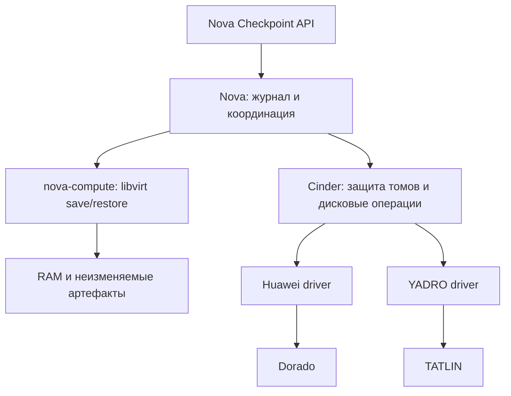

# Instance Checkpoint для Nova/Cinder: Huawei Dorado и YADRO TATLIN

**Дата:** 2026-10-06  
**Статус:** согласована пользователем как основа плана C1; реализация не начата.  
**Основание:** [исследование](../../../deliverables/checkpoint-patches-research-20261010/research/openstack_vm_snapshot_ram_nova_extension.md) и [вывод по драйверам](../../../deliverables/checkpoint-patches-research-20261010/research/openstack_ram_checkpoint_dorado_tatlin_conclusion.md).

## 1. Результат и границы первого варианта

Пользователь создаёт именованную точку восстановления работающей ВМ, продолжает работу, затем возвращает **эту же ВМ** к выбранной точке. Восстанавливаются RAM, CPU/device state и содержимое всех её дисков. `server UUID`, `volume UUID`, `port UUID` и MAC-адреса сохраняются. Cinder attachment UUID может измениться при переподключении.

Целевые СХД, заданные пользователем: **Huawei Dorado и YADRO TATLIN**. Версии массивов, ПО, драйверов и протокол подключения пока неизвестны. Их отсутствие не препятствует разработке общего контракта, но запрещает объявлять реальный backend поддержанным.

Предлагаемые ограничения первого варианта:

| Область | Граница |
|---|---|
| Гипервизор | libvirt/KVM, восстановление на том же compute |
| Диски | Root и все изменяемые диски — Cinder volumes; без local ephemeral/swap и подключённых файловых shares |
| Доступ к дискам | Единственный потребитель — данная ВМ; multiattach и внешние писатели не поддерживаются |
| Устройства | Без PCI passthrough, SR-IOV, vGPU, vDPA, vTPM, confidential VM |
| Firmware | BIOS; UEFI/NVRAM — отдельное расширение |
| Read-only носители | Допускается неизменяемый config-drive, если его содержимое сохраняется вместе с checkpoint; другие local media отклоняются |
| Создание | Только для `ACTIVE/RUNNING`, без другого task state |
| Откат | Для `ACTIVE/RUNNING` или `STOPPED/SHUTOFF`, при совпадении конфигурации устройств |
| Согласованность | RAM и диски одной остановленной ВМ; согласованность внешних приложений и распределённых систем не обещается |
| Хранилище RAM | Выделенный защищённый POSIX-каталог, доступный libvirt и nova-compute; общий каталог не означает поддержку восстановления на другом compute |
| Операции | Create, list, show, revert, delete; минимум две независимые точки восстановления |

**Рабочее допущение для согласования:** разрешена остановка выполнения ВМ на время сохранения RAM, создания снимков и восстановления runtime. Нулевая или ограниченная несколькими миллисекундами пауза не является гарантией этого варианта. Если нужна минимальная пауза с первого этапа, данный алгоритм должен быть пересмотрен до реализации.

### Ориентир VMware

В ответ на вопрос о допустимой паузе пользователь уточнил: «как у VMware?». Это трактуется как запрос на сравнение поведения, а не согласие на произвольную длительность остановки.

VMware описывает snapshot с памятью как сохранение состояния с возможностью вернуться к работающей ВМ; при создании возникает `stun`. [Описание VMware/Broadcom](https://knowledge.broadcom.com/external/article/342618/overview-of-virtual-machine-snapshots-in.html).

Целевой пользовательский сценарий здесь такой же: создать точку, продолжить выполнение без загрузки гостевой ОС заново, позднее восстановить сохранённые процессы и диски. Предложенный `save → snapshots → restore` может иметь более длительную паузу: он включает чтение RAM обратно. Поэтому он рассматривается как первоначальный проверяемый вариант, **не как доказанный аналог VMware по производительности**.

Приёмка отдельно измеряет длительность недоступности guest. Если этот вариант не укладывается в согласованный бюджет остановки, потребуется отдельная оптимизация сохранения runtime; сравнение должно выполняться на одинаковых объёмах RAM/дисков и нагрузке. Работа над общим Cinder-контрактом от выбора конкретного механизма сохранения RAM не зависит.

Эти ограничения приняты как основа планирования. Численный бюджет остановки остаётся отдельным критерием стендовой приёмки. Полное соответствие исходному широкому ТЗ, включая любой storage backend, миграцию и произвольные устройства, первым вариантом не заявляется.

## 2. Выбор подхода

| Подход | Свойства | Решение для проекта |
|---|---|---|
| RAM save/restore + снимки и откат средствами СХД через Cinder | Общая модель для SAN; сохраняет владение дисками в Cinder; требует проверенного драйвера | Рекомендуется |
| RAM save/restore + полное копирование томов | В архиве уже есть общий путь копирования; время остановки зависит от полного объёма дисков; не даёт моментальный CoW/ROW snapshot | Не включать как скрытый fallback новой функции |
| qcow2 overlays поверх SAN volumes | Создаёт дополнительную цепочку дисков и ответственность за её хранение, миграцию и консолидацию | Не входит в первый вариант |

Обычные Cinder snapshots и `revert` сохраняют своё прежнее поведение. Строгие требования нового checkpoint-контракта применяются только к новой функции.

## 3. Владение состоянием

- **Nova API** проверяет права на server, возвращает checkpoint и состояние операции, маршрутизирует запрос в cell владельца ВМ.
- **Nova** хранит checkpoint, журнал фаз, связи с дисками и конфигурацию ВМ. Conductor выполняет координацию и сверку незавершённых операций; только compute-владелец вызывает libvirt и os-brick.
- **Cinder** хранит защищённые связи томов/snapshots с checkpoint, резервирование операций и результаты вызовов драйвера. Прямые обращения к Cinder не обходят эти ограничения.
- **Драйвер СХД** создаёт snapshot, выполняет откат выбранного snapshot в исходный том, удаляет snapshot и позволяет определить результат асинхронной операции.
- **Checkpoint store** хранит RAM и копии неизменяемых локальных артефактов; пути задаёт сервис, а не пользователь API.

Nova не обращается к REST API массивов напрямую. Изменяемая пользователем metadata не служит источником владения, блокировки или доказательством возможности отката.

## 4. Контракт возможностей Cinder

Проверка относится к **конкретному тому и его текущему backend/pool**, а не к строке имени вендора. Её результат содержит:

| Поле | Значение |
|---|---|
| `contract_version` | Версия checkpoint-контракта, первоначально `1` |
| `native_snapshot` | Снимок создаётся средствами СХД без полного копирования тома |
| `snapshot_semantics` | Подтверждённый механизм: `cow`, `row` или `unknown` |
| `arbitrary_inplace_revert` | Откат выбранного snapshot в исходный том с сохранением Cinder volume UUID |
| `preserves_other_checkpoints` | Откат не уничтожает и не изменяет другие сохранённые точки |
| `independent_snapshot_delete` | Удаление одной точки сохраняет остальные точки и текущее содержимое тома |
| `operation_reconciliation` | Повторный запрос может определить результат ранее начатой операции без слепого повторения |
| `consistent_group_snapshot` | Дополнительная возможность; не обязательна для последовательных снимков при полном отсутствии записей |
| `driver_identity` | Класс/версия драйвера и идентификатор поддержанного профиля совместимости |
| `unsupported_reasons` | Стабильные коды причин отказа без секретов и management-адресов |

Новая функция разрешается только при подтверждённых обязательных возможностях. `unknown`, отсутствующий метод или недоступный backend дают отказ **до сохранения RAM**. Декларация возможностей драйвера сопровождается read-only проверкой конкретного ресурса и привязкой к проверенному профилю model/firmware/driver/transport/pool; одна настройка администратора не доказывает поддержку.

По текущему архиву:

- Huawei: создание snapshot имеется; новый контракт отката и восстановления результатов операций ещё не реализован и не проверен.
- TATLIN: архивный snapshot использует копирование; требуется другой драйвер либо реализация подтверждённых native API.
- Оба backend первоначально должны возвращать `supported=false` для **полного checkpoint-контракта**, пока адаптер и профиль не готовы.

ROW отражается в ответе буквально. Его принятие как эквивалента требованию CoW является отдельным решением по ТЗ, а не переименованием свойства в коде.

### Операции контракта

Сервисный интерфейс Cinder обслуживает `reserve`, `snapshot`, `revert`, `delete_snapshot`, `operation_show` и `release` для checkpoint. Это предлагаемые имена операций, не существующий API. Конкретные REST routes и schema будут описаны в отдельной спецификации пакета Cinder до его реализации.

Каждая операция имеет UUID, checkpoint UUID, исходный volume UUID, project UUID, действие, payload hash и поколение владельца. Идентификатор snapshot создаётся и сохраняется до отправки запроса массиву. Повтор запроса с тем же UUID и тем же payload возвращает ту же операцию; другой payload даёт `409`.

Сервисные изменения доступны только доверенному Nova service identity с проверкой project/volume ownership. Tenant не может самостоятельно присвоить себе владельца операции или снять защиту. Пользовательские API Nova по-прежнему проверяют права на server.

Асинхронное принятие Cinder-запроса не означает завершения снимка. Nova ждёт конечного результата и подтверждённого snapshot `available`.

## 5. Журнал, защита ресурсов и конкуренция

Checkpoint хранится в cell DB рядом с instance. API DB используется только для глобального учёта квот там, где требуется агрегирование между cells.

Логические записи Nova:

- `InstanceCheckpoint`: UUID, instance/project/user, имя, статус, host/node, generation, версия формата, fingerprint конфигурации, manifest артефактов и ссылка на текущую операцию.
- `InstanceCheckpointDisk`: checkpoint UUID, volume/BDM UUID, snapshot UUID, устройство/serial, размер, профиль backend, результат и идентификатор Cinder-операции.
- `InstanceCheckpointOperation`: UUID, вид операции, фаза, payload hash, generation, исходное состояние ВМ, timestamps, сведения о последних подтверждённых эффектах и безопасный код ошибки.

В Cinder отдельно хранятся ссылки checkpoint → volume/snapshot, владелец текущей операции и журнал её результата. Пользовательская metadata остаётся информационной.

**Защита на время операции:** Nova атомарно занимает instance через проверку `expected_task_state`; Cinder резервирует весь набор томов в порядке UUID. При конфликте до начала побочных эффектов освобождается только собственное резервирование. Блокируются чужие snapshot/restore/attach/detach/retype/extend/delete/transfer/migrate и прочие изменения источников данных. Внутреннее переподключение разрешено только текущей checkpoint-операции.

**Защита на время существования checkpoint:** блокируются изменения топологии ВМ и идентичности её дисков: resize, rebuild, миграция, evacuate, shelve/offload, attach/detach, retype/extend/delete/transfer исходного тома. Защищённый snapshot нельзя удалить, использовать для зависимого clone или откатить напрямую, обходя Nova. Удаление server требует предварительного удаления checkpoints.

Добавление runtime SSH key из вашего форка также блокируется, если оно изменяет сохранённый config-drive или конфигурацию. Обычные изменения содержимого guest-дисков разрешены; именно их пользователь впоследствии откатывает. Start/stop/reboot разрешены между checkpoint-операциями при неизменной топологии.

Security groups и control-plane metadata не восстанавливаются из старой копии Nova DB. Перед restore используются актуальные разрешённые сетевые настройки при сохранении идентичности устройств. Удалённый порт или несовместимый device fingerprint означает отказ до отката дисков.

Поколение владельца защищает от запоздавших RPC и результатов, но не способно отменить уже отправленную команду массиву. Истечение lease или timeout **не снимает защиту автоматически**: сначала устанавливается состояние предыдущей операции. Пока это невозможно, конфликтующие операции запрещены.

HA-восстановление на другом compute в этот профиль не входит. Автоматическая эвакуация при существующем checkpoint будет конфликтовать с ограничением на смену host; такую ВМ нельзя объявлять совместимой с данным HA-сценарием без отдельного проекта интеграции.

## 6. Создание checkpoint

1. Проверить права, состояния, профиль устройств, наличие всех BDM и соответствие фактическому domain XML. Проверить store, свободное место и квоты; получить и сохранить capability-ответы Cinder.
2. Атомарно создать operation/checkpoint и занять instance. Зарезервировать все тома в Cinder. Повторно проверить фактическую топологию и отсутствие иных писателей.
3. Сохранить fingerprint и неизменяемые артефакты config-drive. Начать сохранение RAM в уникальный staging-файл. Использовать отдельный libvirt save-файл, а не слот `managedSave`, используемый обычным `suspend`.
4. Дождаться успешного сохранения runtime, прекращения выполнения domain и предусмотренного проверенным стеком завершения дисковых I/O. Сам по себе `pause vCPU` не считается достаточным доказательством завершения записи на SAN. Неподтверждённая семантика cache/flush исключает профиль из поддержки.
5. Зафиксировать RAM-файл и его manifest долговечно: завершить запись, обеспечить `fsync` файла и каталога, записать размер/checksum. Между остановкой runtime и завершением всех snapshots новые записи в тома запрещены.
6. Запросить native snapshots всех томов и дождаться подтверждения каждого. Снимки могут быть последовательными, поскольку диски не меняются; ответ описывает это как согласованность остановленной ВМ, а не storage-atomic group transaction.
7. Долговечно записать полный manifest: одна RAM-точка и полный набор snapshot UUID. Восстановить domain на прежнем compute из RAM-файла сначала в paused-состоянии, сверить устройства и подключения, затем возобновить выполнение.
8. После подтверждения `RUNNING` перевести checkpoint в `available`, завершить operation и снять временное резервирование. Долговременные ссылки и защита топологии сохраняются.

Libvirt документирует, что успешный `virDomainSaveFlags()` сохраняет память и прекращает работу domain; `virDomainRestoreFlags()` восстанавливает сохранённый domain и позволяет изменить host-specific части XML. Предлагаемый алгоритм использует эти примитивы, но его согласованность с конкретным SAN и cache mode подлежит стендовой проверке. [Документация libvirt](https://libvirt.org/html/libvirt-libvirt-domain.html#virDomainSaveFlags).

QGA filesystem freeze в первый вариант не включён: заявляется восстановление согласованного runtime, а не application-consistent backup. Добавление freeze потребует обработки thaw после **каждого** restore, включая откат старой точки, содержащей состояние frozen guest.

После создания RAM-файл остаётся неизменяемым и пригодным для повторного restore. Такой режим использования, checksum до/после restore и поведение libvirt при повторном чтении входят в обязательную проверку выбранного стека.

## 7. Откат checkpoint

1. Проверить целостность RAM и manifest, существование всех snapshots, совпадение конфигурации и готовность backend. Получить исключительное владение instance и всем набором томов.
2. Остановить текущий domain и подтвердить отсутствие дисковых I/O. Данные, появившиеся после checkpoint, должны быть отброшены по смыслу пользовательского `revert`.
3. Разорвать host connections через штатные пути compute/os-brick и завершить удаление Cinder attachments. Сохранить BDM и volume UUID; не подменять том клоном с другим UUID. Проверить, что тома действительно `available` и недоступны другому писателю под защитой операции.
4. Откатить каждый исходный том к **своему** snapshot из manifest. Общий fallback с копированием для новой функции запрещён. Дождаться подтверждения всех операций.
5. Создать новые attachments для той же ВМ, получить актуальный `connection_info`, подключить тома и сохранить новые attachment UUID в BDM. Проверить соответствие volume UUID, guest serial и адресов устройств.
6. Восстановить RAM в paused domain. Допускаются только совместимые изменения host-specific путей и текущих подключений; нельзя слепо использовать старые `/dev/*`, секреты или устаревший `connection_info` из XML.
7. Сверить состояние и возобновить выполнение. Checkpoint снова `available`, остальные точки сохранены. Состояние Nova синхронизируется только после подтверждённого runtime-результата.

При частичном откате дисков ВМ остаётся остановленной. Автоматически загружать её с произвольной смесью старых и новых дисков запрещено. В первом варианте не обещается автоматический возврат к состоянию до неудачного `revert`: требуется сверка завершённых операций и продолжение того же отката либо явная процедура восстановления.

## 8. Удаление и состояния

Удаление checkpoint не меняет текущие данные ВМ и другие точки. Оно удаляет только принадлежащие checkpoint Cinder snapshots и RAM/config artifacts. Если backend не может сохранить остальные точки или есть запрещённая зависимость, операция завершается конфликтом, а не каскадным удалением.

Сначала удаляются snapshots и подтверждается завершение backend cleanup; затем удаляются RAM и локальные артефакты. Только после этого освобождаются квоты и долговременные ссылки. Частично удалённый checkpoint не пригоден для restore, но остаётся видимым до завершения cleanup. Один лишь `404` в Cinder не доказывает отсутствие backend-артефакта после неопределённого сбоя.

Для SAN нет локальной qcow2 backing chain. Освобождение snapshot-зависимостей выполняет driver/array; заявлять общую qcow2-консолидацию здесь нельзя. Отдельный пользовательский `consolidate` в первый вариант не входит.

| Состояние checkpoint | Смысл |
|---|---|
| `creating` | Идёт создание; restore запрещён |
| `available` | Полный набор артефактов создан, операция создания завершена |
| `reverting` | Идёт откат; конфликтующие действия запрещены |
| `deleting` | Идёт удаление; restore запрещён |
| `error` | Создание не завершилось; остатки перечислены в журнале |
| `error_reverting` | Откат не завершился; ВМ может требовать восстановления |
| `error_deleting` | Cleanup не завершён; остатки остаются учтёнными |
| `invalid` | Утрачены артефакты или нарушена совместимость |
| `deleted` | Cleanup подтверждён; остаётся служебная tombstone-запись |

Отдельный статус operation `recovery_required` обозначает неопределённый результат. Он не равен успешному завершению и не допускает разблокировку instance/томов.

## 9. Перезапуск, таймауты и восстановление

| Сбой | Обязательное поведение |
|---|---|
| Отказ preflight | ВМ и диски не меняются; вернуть конкретную причину |
| Save завершился ошибкой | Проверить фактическое состояние domain и RAM-файла; не предполагать, что ВМ всё ещё работает |
| Снимок одного тома не создан | Не публиковать checkpoint; установить исход остальных запросов; восстановить исходный runtime, когда это доказанно безопасно; удалить подтверждённые остатки |
| Потерян ответ массива или Cinder | Найти результат по operation/snapshot UUID; без доказательства результата не повторять разрушительный вызов |
| Часть дисков уже восстановлена из snapshots | Оставить ВМ остановленной и защиту активной; сверять и продолжать ту же операцию |
| Restore запустил domain, но ответ потерян | Проверить домен и маркер операции; повторный restore поверх работающей ВМ запрещён |
| Перезапуск nova-compute/conductor | Читать журнал до обычной автозагрузки instance; продолжать только подтверждённые переходы |
| Недоступен host/backend | `recovery_required`; время ожидания не является доказательством завершения |
| Ошибка удаления артефакта | Не скрывать checkpoint и не освобождать соответствующую квоту до подтверждения cleanup |

Журнал записывает намерение **до** эффекта и подтверждение **после** него. При пробеле между этими записями выполняется read-only сверка. Смена владельца разрешается только после исключения продолжающейся работы старого владельца.

Периодическая сверка и служебный `reconcile` не выполняют автоматический force-reset состояния и не снимают блокировки по одному timeout. Если результат нельзя установить, требуется операторское восстановление с указанием затронутых ресурсов и последней подтверждённой фазы.

## 10. API, совместимость и защита артефактов

Пользовательский API Nova сохраняет предложенные в исследовании ресурсы:

- `POST /servers/{server_uuid}/checkpoints` — создание, `202` с checkpoint и operation UUID;
- `GET /servers/{server_uuid}/checkpoints` и `GET .../{checkpoint_uuid}` — список и состояние;
- `POST .../{checkpoint_uuid}/action` с `revert` — откат, `202`;
- `DELETE .../{checkpoint_uuid}` — удаление, `202`;
- `GET /servers/{server_uuid}/checkpoint-capabilities` — доступность профиля и причины отказа.

В первом варианте создание всегда включает память и все допустимые диски; выбор части дисков запрещён. Имя — отображаемое поле, не путь. `include_memory=false`, запрос quiesce и неподдержанное целевое power state отклоняются с `400`, а не молча игнорируются.

Изменяющий запрос несёт `request_id` UUID в теле create/revert; для DELETE — в заголовке `OpenStack-Checkpoint-Request-ID`. Дедупликация привязана к project, instance, действию и request ID. Тот же ключ с иным телом даёт `409`; операция и её tombstone сохраняются после удаления checkpoint, чтобы повтор не создавал новые эффекты. Повторный DELETE завершённой собственной операции возвращает её конечное состояние. Срок хранения журналов задаётся общей политикой retention; клиент не должен переиспользовать UUID.

Чужой checkpoint не раскрывается через UUID другого server/project. Ответы содержат безопасные статусы и причины, но не host paths, RAM, XML с секретами или connection credentials.

Функция по умолчанию отключена. Пока существуют checkpoints или незавершённые операции, её отключение запрещает новые create, но не отключает guard/recovery и необходимые read/revert/delete.

Микроверсии и RPC расширяются отдельно от прежних операций. В архиве Nova максимум `2.105`, Compute RPC `6.4`, service version `68`; Cinder максимум `3.71`, Volume RPC `3.20`. Эти значения являются исходной точкой, **не утверждёнными номерами нового API**. Новые номера резервируются после проверки всех расширений форков в спецификациях соответствующих пакетов. Старые сервисы должны отклонять новую операцию до побочных эффектов; маршруты старых версий сохраняют поведение.

RAM-store должен иметь шифрование at rest, ограничения доступа для сервисных пользователей, проверку symlink/path traversal, учёт staging-файлов и свободного места. Проверка checksum обнаруживает повреждение; она не заменяет контроль доступа и защиту от подмены. Пользователь не скачивает RAM через этот API. Интеграция с Barbican и способ управления ключами требуют отдельного решения до production; наличие зашифрованного тома не выдаётся за уже реализованную интеграцию Barbican.

Квоты учитывают число checkpoints на instance/project, зарезервированный объём RAM и фактические артефакты. Резервирование должно быть атомарным; проверка свободного места дополняет, но не заменяет квоту. Cinder snapshots учитываются штатными квотами Cinder. Освобождение квот производится по подтверждённому удалению, включая остатки ошибок.

## 11. Деление на пакеты работ

Это границы последующих спецификаций и патчей, а не утверждённый пошаговый план реализации.

| Пакет | Состав и критерий готовности |
|---|---|
| C1 — общий контракт Cinder | Capability, durable operations, защита volume/snapshot, API/RPC/objects/migrations. На неподдержанном драйвере предсказуемый отказ; проверка на fake driver не означает поддержку массива |
| D1/D2 — адаптеры Dorado/TATLIN | Подтверждённые native snapshot/revert/delete/reconciliation для конкретных профилей; один адаптер не блокирует разработку другого |
| N1 — общая модель Nova | Cell-aware checkpoint/operation, policy/API, квоты, guards, восстановление журнала |
| N2 — libvirt и интеграция | Save/restore, Cinder orchestration, переподключение дисков, immutable RAM/config artifacts |
| V1 — стендовая приёмка | Реальные RAM/disk revert, идентификаторы, сбои, длительность остановки отдельно для каждой СХД |

**Первый предлагаемый пакет для детальной спецификации и реализации — C1.** Он не зависит от выдуманных REST API массивов и создаёт проверяемую основу. Полный пользовательский checkpoint включается только после N1/N2 и хотя бы одного проверенного D-профиля.

## 12. Проверки и критерии приёмки

Локальные проверки должны охватывать API/policy, дедупликацию, миграции БД, сериализацию versioned objects, RPC compatibility и конкурирующие операции. Нужны тесты прямого обхода через Cinder, включая попытку удалить snapshot или подключить том во время revert.

Сценарии отказов проверяются на каждом переходе «намерение → эффект → подтверждение», включая потерю ответа при фактически завершённом эффекте. Проверяются два одновременных запроса, запоздавший RPC, смена владельца, перезапуск сервисов и невозможность старой операции снять чужую защиту.

Обязательная стендовая приёмка на каждом заявленном профиле:

1. Работающий процесс хранит случайное значение только в RAM; отдельный маркер записан на каждый диск.
2. Создать A, изменить RAM/диски, создать B, снова изменить состояние.
3. Откатить A: подтвердить состояние процесса и всех дисков, прежние server/volume/port UUID.
4. Проверить, что B сохранился и также восстанавливается; повторно восстановить A.
5. Удалить A при существующем B; подтвердить неизменность текущих данных и возможность восстановления B.
6. Вызвать отказ после частичного revert: ВМ не должна запускаться на смешанном наборе дисков.
7. Проверить restart compute/conductor, timeout Cinder, отсутствие места в RAM-store и отказ одного backend.
8. Измерить полную остановку guest, включая сохранение и повторное чтение RAM, и фактические объёмы артефактов; отдельно проверить, что native snapshot не оказался полным копированием. Не подменять время недоступности общим временем задачи API.

Unit/fake integration tests подтверждают код и контракт. Они не доказывают согласованность SAN, поддержку native rollback, восстановление RAM или заявленное время остановки на реальном стенде.

## 13. Что требуется для следующего решения

Для согласования этой общей архитектуры достаточно выбрать границы первого варианта, включая допустимость остановки ВМ и изменение attachment UUID.

Для адаптеров D1/D2 необходимы модели/ПО/пулы массивов, transport, точные версии и исходники драйверов, документация их snapshot/revert API и возможность read-only проверки профиля. До получения этих данных соответствующие profiles остаются неподдержанными.

Для production отдельно определяются RAM-store и управление ключами, лимиты, наблюдаемость и процедура операторского восстановления. До этого результат может быть принят только как реализация и стендовый прототип в явно заданных границах.

## 14. Привязка к исходникам и состояние документа

| Точка расширения | Текущее основание |
|---|---|
| Nova compute API (`sources/nova-pvs/nova/compute/api.py`) | `check_instance_state`, `snapshot_volume_backed`, `add_runtime_ssh_key` |
| Nova compute manager (`sources/nova-pvs/nova/compute/manager.py`) | `_init_instance`, `_query_driver_power_state_and_sync`, suspend/resume |
| Nova Cinder adapter (`sources/nova-pvs/nova/volume/cinder.py`) | Snapshot и attachment wrappers; отдельного checkpoint-контракта нет |
| Nova libvirt Guest (`sources/nova-pvs/nova/virt/libvirt/guest.py`) | `save_memory_state()` использует `managedSave`; для checkpoint нужен отдельный save path |
| Cinder volume API (`sources/cinder-pvs/cinder/volume/api.py`) | Snapshot validation, attachments, состояния и квоты |
| Cinder volume manager (`sources/cinder-pvs/cinder/volume/manager.py`) | Native/fallback revert; fallback не подходит новому контракту |
| Cinder REST revert (`sources/cinder-pvs/cinder/api/v3/volumes.py`) | Проверка latest snapshot в существующем API |

Существующие исследования и код не изменены. Документ не является свидетельством реализованной поддержки. Рабочая папка не содержит Git-репозитория; спецификация сохранена файлом без коммита.
