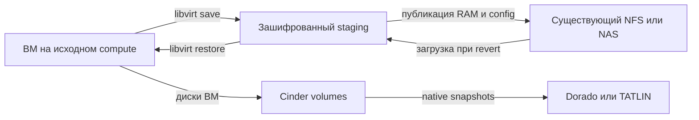

# N2: исполнитель Instance Checkpoint — libvirt, RAM-store и Cinder

Дата: 2026-10-07. Статус: **согласована пользователем; реализация N2 не начата**.

Подробные планы: [C1.1](../plans/2026-10-07-cinder-checkpoint-continuation-c11.md)
и [N2](../plans/2026-10-07-nova-checkpoint-executor-n2.md).

Основа: [общая архитектура](2026-10-06-instance-checkpoints-dorado-tatlin-design.md),
пакет N1 (`deliverables/nova-checkpoint-model-n1/README.md`),
пакет C1 (`deliverables/cinder-checkpoint-contract-c1/README.md`).
Состояние завершённых пакетов определяется их отчётами, а не историческими
отметками «ещё не реализован» в первоначальных спецификациях.

## 1. Цель и согласованные границы

Пользователь сохраняет работающую ВМ вместе с RAM и всеми записываемыми
дисками, продолжает работу, затем возвращает ту же ВМ к выбранной точке.
Сохраняются server/volume/port UUID, MAC и guest device identity.
Attachment UUID и host device paths могут измениться.

Первый профиль — `kvm-bios-same-host-v1`: KVM/libvirt, BIOS, восстановление
на исходном compute, все записываемые диски принадлежат Cinder.
Локальные ephemeral/swap, writable config-drive, shares, multiattach,
passthrough/SR-IOV/mdev, vTPM, UEFI/NVRAM и confidential guests исключены.
Неизменяемый read-only config-drive включается в артефакты.
Остановка выполнения ВМ допустима; численный предел паузы не согласован.
QGA freeze, восстановление сетевого control plane и HA на другом хосте
не входят в этот профиль.

Пользователь уточнил, что способ хранения ещё не выбран, и подтвердил наличие
NFS или NAS в инфраструктуре. Поэтому раздел 4 рекомендует использовать
существующий файловый сервис. Его конкретный продукт, протокол, настройки
и пригодность для RAM-store ещё не проверены.

Критерий результата: повторяемые create A → create B → revert A → revert B
с проверкой RAM и каждого диска; удаление A сохраняет B и текущие данные.
Неизвестный результат эффекта удерживает защиту; частичный revert не допускает
запуска ВМ на смеси дисковых состояний.

## 2. Исходная точка и найденные разрывы интеграции

Прочитаны рабочие копии, обе без tracked-изменений:

| Контур | Проверенное состояние |
|---|---|
| Nova N1 | `f6ead340524374ea9d287068124c0add89137c6f`, API 2.106, compute RPC 6.5, compute-task RPC 1.26, service 69 |
| Cinder C1 | `d2d14a5251fa7f61771f83bfbf50f12215dd051d`, частный API 3.72, volume RPC 3.21, driver contract 1 |
| Nova executor | Базовые `checkpoint_probe/execute/query`; production effects не реализованы |
| Nova recovery | Coordinator уже выбирает query при неизвестных шагах и execute при отсутствии таких шагов; эту координацию сохраняем |
| Cinder ownership | Проверяется точное совпадение `(project_id, user_id, service_user_id)` |
| Cinder attachments | Операционный scope доступен с 3.72; штатные Nova wrappers используют 3.44 и не передают этот scope |
| Nova compound steps | Snapshot IDs и артефакты фиксируются после полного успеха фазы; частичный эффект не представлен отдельным терминальным результатом |
| Квоты | N1 учитывает создание и постоянные артефакты; повторная загрузка RAM для revert требует отдельного временного reservation |

Это проверка исходников, не работающего облака. Поддержка конкретных версий
QEMU/libvirt, SAN, NAS и шифрования здесь не подтверждается.

## 3. Выбор подхода и границы пакетов

| Вариант | Достоинства | Цена и решение |
|---|---|---|
| Общий файловый RAM-store + ограниченный локальный staging | Обычные файлы для libvirt; окончательная RAM-копия вне локального диска compute; контролируемые временные записи | Два места хранения и дополнительный I/O; рекомендуемый первый вариант |
| Только локальный зашифрованный store | Меньше компонентов, отсутствует передача полного RAM-файла по сети | Потеря локального диска уничтожает точки; допустим для лабораторного прототипа, не выбран по умолчанию |
| Object storage + зашифрованный staging | Подходит при уже эксплуатируемом объектном сервисе | Нужны отдельные upload/download, multipart cleanup и правила публикации; отдельный store adapter, не первый вариант |

Общее хранилище не меняет same-host ограничения. Сохранность RAM при отказе
локального диска не означает готовность автоматической эвакуации ВМ.

N2 разбивается на проверяемые части:

1. **C1.1 — продолжение принятой операции сервисом:** совместимое дополнение
   Cinder для фоновой работы и точного восстановления attachment-запросов.
2. **N2-A — реальные эффекты Nova:** журнал подшагов, store, runtime,
   scoped Cinder client, сборка workflow и тесты отказов.
3. **D1/D2 и V1:** профиль массива и стендовая квалификация связки
   QEMU/libvirt/os-brick/storage/RAM-store.

Готовые серии C1/N1 не переписываются. C1.1 и N2-A должны иметь отдельные
серии поверх зафиксированных commits. Их подробные планы составляются после
согласования этого проекта. Драйверы Dorado/TATLIN не реализуются внутри N2.

## 4. RAM-store: рекомендуемая схема

### 4.1. Постоянная и временная копии

**Постоянная копия:** выделенное общее файловое хранилище, доступное нужным
compute по одному проверенному профилю. Пользователь подтвердил наличие
NFS/NAS; первый кандидат — отдельный export на этом сервисе. Его пригодность
ещё не установлена. CephFS имеет смысл оценивать только при его наличии;
разворачивать отдельный Ceph только ради этой функции не предлагается.

**Временная копия:** отдельный зашифрованный staging на исходном compute.
Libvirt сохраняет RAM туда; Nova публикует неизменяемую копию в общем store.
Для revert Nova проверяет shared artifact, загружает его в ограниченный
staging, затем передаёт файл libvirt. До получения и проверки всей RAM-копии
и резервирования необходимых ресурсов текущая ВМ не останавливается.

Такой staging нужен для контроля записи процесса libvirt и восстановления
после обрыва передачи. Прямой save на NFS не запрещён архитектурой, но станет
отдельным профилем лишь после проверки долговечности, ограничения размера
и поведения незавершённого save при потере сервера.

Libvirt предоставляет save/restore через файловый путь; успешный save завершает
работу domain, restore допускает paused-состояние и поддержанные изменения
host-specific XML. Это основание выбора файлового интерфейса, а не доказательство
согласованности SAN или NAS. [Libvirt save/restore API](https://libvirt.org/html/libvirt-libvirt-domain.html#virDomainSaveFlags).

### 4.2. Защита и размещение

Shared store и staging требуют шифрования at rest. Для общего store также
нужна защита передачи: проверенный зашифрованный transport; одна изоляция
storage VLAN этим требованием не считается. Управление ключами принадлежит
инфраструктуре NAS/файлового сервиса и зашифрованного staging. Nova не создаёт
ключи массивов и не сохраняет их в journal. Barbican не объявляется уже
интегрированным. Перезапуск с недоступными ключами запрещает новые эффекты.

RAM, сохранённый XML и config-drive считаются чувствительными данными.
Доступ разрешается только нужным сервисным процессам; SELinux/AppArmor,
libvirt UID/GID и NFS access rules проверяются в профиле. Guests и project
users не получают mount, URL скачивания или права чтения этих файлов.
Поведение резервных копий store и их ключей относится к инфраструктуре;
удаление checkpoint не выдаётся за криптографическое уничтожение всех backups.

Namespace: deployment UUID → cell UUID → hash project identity → instance UUID →
checkpoint UUID → artifact UUID. UUID проверяются, project component кодируется
сервисом в фиксированный digest; произвольные строки пути не принимаются.
Отображаемое имя checkpoint никогда не используется как путь.
В journal передаётся opaque logical ID без разделителей, связанный с полным
namespace. Ресурсы разных ВМ/cells не используют общий raw handle и не
дедуплицируются без отдельного reference-counting контракта.

Открытие выполняется относительно проверенного корня с запретом symlink,
path traversal и неожиданных hardlinks. Перед каждой записью сверяются
mount identity, store UUID и профиль: потеря mount не должна переключать
запись в обычный локальный каталог под mountpoint. Доступность другого compute
к тем же файлам не даёт ему владения операцией.

### 4.3. Публикация и удаление

Каждая запись заранее имеет artifact UUID, владельца, ограничение размера и
hash immutable intent. Окончательный manifest с размером/checksum формируется
после записи, связывается с этим intent и публикуется однократно.
Локальный save получает отдельный путь,
не связанный со штатным `managedSave`.

Публикация: закончить save → подтвердить отсутствие writer → fsync staging →
вычислить размер/checksum → передать в уникальный shared temporary object →
fsync → проверить содержимое → atomically publish без замены существующего
чужого объекта → fsync каталога → сохранить подтверждение в cell journal.
Повторное наблюдение принимает только тот же namespace, hash и размер.
Сам по себе успешно выполненный rename не подтверждает долговечность сервера;
это свойство проверяется на конкретном storage profile.

Окончательные RAM/config artifacts неизменяемы. Restore не редактирует
исходный save image; актуальный host XML передаётся отдельно. Удаление
проверяет владельца, отсутствие reader/writer и подтверждает отсутствие
окончательных и временных копий. Timeout/недоступный mount/одиночный `404`
не подтверждают cleanup.

### 4.4. Бюджет и свободное место

Бюджет создаваемой точки включает пик одновременного существования shared
и staging RAM, config/runtime files, upload temporary files и служебного
manifest. Размер flavor RAM сам по себе не задаёт достаточную верхнюю
границу save image: учитываются max memory и состояние устройств.

Предлагаемый staging profile — выделенный зашифрованный XFS с project quota
для каждого staging workspace. XFS поддерживает project quota, но наличие
mount option не доказывает её enforcement для конкретного writer. Включение
профиля требует испытания реального libvirt writer, превышения лимита и
сохранения reservation при ошибке. [Linux XFS quota options](https://docs.kernel.org/admin-guide/xfs.html).

Проверяются отдельно логические размеры, выделенные блоки и заранее выделенные
extents; sparse/preallocated файлы не дают бесплатной квоты. Если профиль не
может обеспечить доказанную верхнюю границу записи, он unsupported. Nova
копирует shared files ограниченным writer; бесконтрольных фоновых копий нет.
Storage free space — дополнительная проверка, а не замена project quota.

N2 добавляет временные quota tickets для операций restore/cleanup,
отдельные от постоянной квоты точки. Пока temporary ticket жив, late download
не может появиться после refund; освобождение требует tombstone либо
подтверждённого cleanup. Между API DB и cell DB сохраняется протокол без
общей transaction. Согласованное увеличение бюджета подтверждается до записи.

После успешного create постоянная квота уменьшается до проверенного объёма
shared artifacts только после удаления staging. Чтобы не выдать старое N1
`staging_deleted=true` при живой копии, N2 меняет фазовый контракт: публикация
shared copy и cleanup staging — разные шаги, а usage proof выдаётся после
последнего. Во время restore учитываются и постоянная, и временная копии.

## 5. C1.1: продолжение без сохранённого user token

### 5.1. Решение

Service token не является общим способом заново получить identity произвольного
пользователя после перезапуска. Штатная схема Nova передаёт его вместе с user
token. [Nova 2025.1 service tokens](https://docs.openstack.org/nova/2025.1/admin/configuration/service-user-token.html).
Keystone trusts дают явное делегирование, но требуют собственного жизненного
цикла и выбора прав. [Keystone trusts](https://docs.openstack.org/keystone/latest/user/trusts.html).

Для N2 рекомендуется **service continuation, ограниченное уже принятой
Cinder operation**. Trusts не создаются автоматически. В C1.1 пользовательская
и сервисная identity проверяются при первичном reserve; в той же transaction
сохраняется разрешение указанному Nova service user завершить эту операцию.

Разрешение связано с исходным project/actor, Nova operation UUID, Cinder
operation UUID, generation=1, checkpoint, instance, точным набором volumes
и kind. Исходный actor неизменяем; новый аутентифицированный executor
учитывается отдельно. Изготовление `RequestContext(user_id=старый actor)`
для REST-доступа или ослабление существующего `_owned` запрещено.

### 5.2. Граница интерфейса

Предлагается отдельная частная микроверсия Cinder **3.73** поверх C1 3.72:

- reserve принимает Nova operation UUID и явное разрешение service continuation;
- service lookup по этому UUID возвращает только операцию, делегированную
  аутентифицированному Nova service user из allowlist;
- service actions разрешают execute/query/cleanup/release только для этого
  уже принятого kind и набора ресурсов;
- scoped attachment interface разрешает чтение/отключение старых и создание,
  update/complete новых attachments той же ВМ, строго по фазам revert;
- служебное перечисление чужих операций, резервирование новых ресурсов,
  произвольная смена project/actor и обычный volume API этим доступом не разрешаются.

Сервис аутентифицируется собственным свежим Keystone token; grant UUID не
является bearer secret. Проект владельца берётся из сохранённого grant,
а не из клиентского заголовка. Нужны выделенные policy и внутренний
`AuthorizedCheckpointScope`; policy не расширяет обычные volume routes.
На service-only route executor identity берётся из проверенного token subject
и service role, а не из присланного `service_user_id`. Scope разрешает также
read-only capabilities и resource lookup только для связанных volumes.
Контроль scope повторяется в API, DB, RPC worker и attachment mutation paths.
Отдельно тестируется реальное поведение Keystone middleware с service-only
запросом; синтетический unit context не заменяет эту проверку.

Service continuation живёт до завершения операции. После release разрешено
только чтение tombstone. Отзыв service identity запрещает новые эффекты и не
снимает защиту/квоты. Истечение исходного user token само по себе не отменяет
уже авторизованную операцию. Новый revert/delete требует новой пользовательской
авторизации, даже если checkpoint был создан тем же actor.

Если ответ reserve потерян, service lookup находит принятую запись по Nova
operation UUID. Если reserve **не был принят**, сервис не может сам создать
его от имени пользователя: операция ждёт точного повтора исходным actor с
действующим токеном. `Not found` не доказывает, что поздний reserve не придёт;
автоматического refund/пересоздания нет. Этот предел фонового восстановления
явно отражается в документации и тестах.

Для attachment create требуется durable request key
`(operation, generation, volume, action, child_intent)` и атомарная привязка
выданного attachment UUID. Потерянный ответ разрешается query того же intent;
повтор не создаёт второй attachment. Update/delete/complete также имеют
сохранённый target и результат; отсутствие attachment не подменяет доказательство
отключения os-brick. Старые 3.72 routes сохраняют C1-поведение.

### 5.3. Адаптация Nova

Выделенный Cinder checkpoint client использует проверенную микроверсию и
явный operation scope. Штатные wrappers 3.44 не меняются глобально.
Client сверяет request/kind/checkpoint/instance/volume set и generation
каждого ответа; поля Cinder `commit/abort` переводятся в Nova result только
после проверки всех resource states. `202` не означает завершение эффекта.

Для фонового чтения актуальных Neutron ports используется настроенная и
проверенная сервисная авторизация, ограниченная связанными port IDs.
Произвольный admin context без действительных credentials ею не считается.
Отсутствие доступа до revert запрещает остановку ВМ.

## 6. Журнал N2 и реальные эффекты

### 6.1. Два уровня намерений

N1 operation и parent phase остаются источником владения. N2 добавляет cell
journal дочерних эффектов: stable UUID, parent step, action, resource UUID,
immutable payload hash, executor/store/runtime profile, state, safe evidence.
Child intent фиксируется через OVO/conductor до I/O; прямой SQL из compute
не вводится. Blob XML, ключи, connection_info и raw backend exceptions в
таблицу не записываются.

Для каждого дочернего эффекта допускается только одна initial dispatch.
`dispatching/pending/unknown` означает query существующего intent.
Непредъявленный дочерний эффект можно начать после подтверждения предшественников.
Обычный `query` не выполняет resume, destroy, reconnect, upload, cleanup или
unpause. Для продолжения используется отдельный execute проход под тем же
owner, после чтения подтверждений. generation остаётся 1; takeover отсутствует.

Дочерние состояния: `prepared`, `dispatching`, `pending`, `succeeded`,
`failed_no_effect`, `failed_with_effects`, `unknown`. После частичного child
effect перечень остатков сохраняется отдельно от итогового success; child
остаётся unknown до установления его исхода. Переход в `failed_with_effects`
требует подтверждённого перечня ресурсов и остановки writer, а не одного
exception или timeout. Этот результат разрешает компенсацию, но не повтор
исходного эффекта.

Coordinator N1 уже различает query и execute; N2 расширяет содержимое
compound phase, а не добавляет конкурирующий механизм periodic recovery.
Для parent с ещё не начатыми children v2 вводит результат `ready`:
query установил исход всех уже dispatched children, следующий child разрешён,
но сама фаза ещё не завершена. Evidence содержит revision дочернего journal
и разрешённое продолжение, проверяемые cell DB. Coordinator отправляет новый
`checkpoint_continue` через compute RPC 6.6. Worker делает CAS child claim
под прежним owner; устаревший revision приводит к повторной сверке.
Так parent `pending` не застревает в бесконечном query после завершения
первого child. `ready` не равен success и не разрешает повтор неизвестного
child. Фазы компенсации также проходят через новые child intents.
Startup читает journal раньше обычного autostart/power synchronization.
Наличие operation barrier блокирует и поздние обычные workers.

### 6.2. Частичный результат

В существующем v1 `failed_no_effect` требует `no_effect=true` и
`late_effect_impossible=true`. Эти утверждения нельзя вернуть, когда создан
хотя бы один snapshot или появился RAM staging файл.

Предлагаемый internal contract v2 добавляет `failed_with_effects`: полный
перечень подтверждённых дочерних ресурсов и терминальных результатов,
отсутствие unknown/pending и доказанное отсутствие запоздалого writer.
Список связывается с дочерним journal, а не принимается на доверии из драйвера.
После такого create failure разрешается строго перечисленная компенсация.
Неопределённый дочерний результат оставляет весь parent в recovery_required.

Cleanup snapshot-остатков использует Cinder cleanup исходной create operation.
Незавершённые RAM/config artifacts учитываются с момента открытия, даже если
`runtime_save` не дошёл до success. Их отсутствие в старой success-evidence
не разрешает refund. После частичного disk revert автоматически восстановить
текущую RAM или снять guard нельзя.

## 7. Проверка runtime и алгоритмы

### 7.1. Preflight

Probe сопоставляет Nova DB manifest, фактический active/inactive domain XML,
volume attachments, актуальные ports и зафиксированный эксплуатацией набор
проверенных runtime/storage profiles. Номер версии сервиса и настройка
`enabled=true` сами по себе не означают поддержку.

Сохраняются два разных отпечатка: DB device fingerprint N1 и отдельный
runtime fingerprint N2 (machine type, CPU/features, память, controllers,
guest device addresses, disk serial/cache/format, port identity, immutable
config). Подстановка полного XML в старый DB fingerprint недопустима.
Секретные значения не включаются в hash-источники, уходящие в публичный API.

Create допускается для работающего совместимого domain без block jobs,
managed-save ambiguity и внешних писателей. Revert допускается только при
доказанной совместимости сохранённого runtime с текущим стеком.
Delete и query не требуют работающей ВМ или доступного runtime, если их
конкретные действия ограничены Cinder/store; обязательны ownership и
связность ресурсов. Повторный probe учитывает kind/phase, чтобы ожидаемый
SHUTOFF после save не блокировал собственное recovery.

Libvirt/QEMU update, изменение CPU/machine type или несовпадение ключей
зашифрованных томов не считаются безопасными автоматически. До подтверждения
профиля операция отвергается до остановки/отката; точки сохраняются для cleanup.
Обычный suspend/resume продолжает использовать свой managed-save slot.

### 7.2. Create

1. Preflight → admission N1 и полный peak byte reservation → Cinder reserve
   с действующей пользовательской и сервисной identity.
2. Зафиксировать дочерние IDs RAM/config и runtime fingerprint; повторно
   сверить domain/disks/ports под checkpoint ownership.
3. Save runtime в ограниченный staging; подтвердить завершение libvirt job,
   отсутствие выполняющегося domain и прекращение I/O по проверенному профилю.
   Только pause vCPU и только успешный flush системного файла SAN не заменяют
   этого доказательства.
4. Создать все native Cinder snapshots. До установления результатов всех
   snapshots никакой domain не получает право записи в тома.
5. Опубликовать RAM/config в shared store и подтвердить их долговечность.
6. Restore из staging в paused domain, проверить устройства/текущие подключения,
   затем unpause с отдельным сохранённым intent и подтвердить RUNNING.
7. Удалить staging, подтвердить Cinder release commit, завершить operation,
   выдать available и окончательный usage proof.

Пауза включает сохранение RAM, snapshots, shared publication и restore.
Параллельные загрузки/ранний unpause для сокращения паузы в первый алгоритм
не включаются. Если этот бюджет неприемлем, алгоритм меняется до реализации.

### 7.3. Revert

1. Занять operation, зарезервировать временный бюджет, проверить shared
   manifest, snapshot set, совместимость runtime и текущие Neutron ports.
2. Reserve Cinder с действующей пользовательской и сервисной identity;
   проверить continuation grant. Скачать и полностью проверить RAM/config,
   повторить preflight. Затем остановить domain с durable stop intent и
   подтвердить прекращение I/O. Откат по смыслу запроса отбрасывает текущее
   RAM/disk состояние; страховой снимок текущего состояния автоматически не создаётся.
3. Отключить host connections штатными primitives Nova/os-brick, удалить
   только прежние scoped attachments; подтвердить отсутствие другого writer.
   BDM/volume UUID сохраняются. Не использовать обычный detach path,
   удаляющий BDM или ослабляющий checkpoint guard.
4. Откатить каждый исходный volume к его snapshot; ожидать подтверждения всех.
   Частичное завершение удерживает domain остановленным.
5. Создать scoped attachments, получить актуальный connection_info, подключить
   os-brick, сохранить новые attachment UUID через разрешённый BDM update и
   выполнить attachment complete. Перепроверить соответствие guest devices.
6. Сформировать restore XML с разрешёнными заменами host paths/connection
   references. Guest topology/serial/address/CPU не менять. Повторно проверить
   ports и применить текущую сетевую конфигурацию, не старые security groups.
7. Restore paused → verify → durable unpause → RUNNING → cleanup staging →
   Cinder release commit → завершение и освобождение временной квоты.

Удаление/изменение порта вне Nova не предотвращается Nova guard. Обнаружение
несовместимости после отката удерживает ВМ остановленной; старый Neutron
control plane не восстанавливается автоматически.

### 7.4. Delete и компенсация create

Delete не сохраняет/не восстанавливает RAM и не требует staging-копии:
Cinder reserve → delete snapshots → подтверждение backend cleanup → удалить
shared и известные temporary artifacts → Cinder release → refund N1.
Файл, используемый незавершённым restore, удалять нельзя.

Неудавшийся revert до dispatch `runtime_stop` и до любых disk/attachment
effects может завершиться без изменения текущей ВМ: атомарно запретить поздний
stop в Nova journal, подтвердить Cinder abort, удалить staging и освободить
только temporary ticket. Если stop уже dispatched или его исход неизвестен,
такой путь отмены запрещён. Постоянные артефакты checkpoint сохраняются.

При create failure текущий runtime можно восстановить лишь из полностью
подтверждённого save и после разрешения всех неопределённых disk effects.
Затем удаляются только перечисленные ресурсы этой операции. Если save
повредился, а domain уже остановлен, автоматический успешный rollback
не обещается: recovery_required, защита и учёт остатков сохраняются.

## 8. Восстановление и границы доказательств

| Ситуация | Действие N2 |
|---|---|
| Потерян ответ reserve | Query C1.1 по Nova operation UUID; отсутствие записи не разрешает service-only reserve или refund |
| Save timeout, domain исчез | Проверить job и durable completion seal; один файл/его XML header не доказывают полноценное RAM-сохранение |
| Файл записан, нет completion seal | Не начинать snapshots на основании предположения; query или операторское восстановление |
| Один snapshot создан, второй неизвестен | Запрет restore/unlock; Cinder query всех неопределённых substeps |
| Частичный snapshot set, все результаты известны | `failed_with_effects`, затем учтённая компенсация исходной create operation |
| Shared store недоступен | Новые create/revert прекращаются; незавершённые записи сохраняют ownership и byte reservation |
| RAM скопирована, потерян ответ publish | Проверить immutable owner/manifest/checksum и серверную долговечность; чужой existing object не заменять |
| Attachment создан, ответ потерян | Найти exact child intent в Cinder; не вызывать второе безымянное create |
| Часть volumes reverted | Domain остаётся выключенным; продолжение только ещё не начатых или подтверждённо разрешённых действий той же операции |
| Restore/unpause ответ потерян | Проверить bound runtime identity, metadata marker, job и фактическое power state; marker один не доказывает завершение |
| Compute перезапущен | Durable journal до autostart; неизвестный libvirt job не повторять после одного timeout |
| Ключи/учётная запись отозваны | Удержать состояние, не подменять actor, не снимать guard административным reset |
| Потерян исходный compute | Same-host recovery_required; наличие shared RAM не даёт право takeover на другом compute |

Metadata marker связывает domain с operation/checkpoint/restore child и
runtime fingerprint. Проверяются одновременно marker, фактическое состояние
и установленный исход предыдущего вызова; PID или отсутствие job отдельно
не доказывают, что поздний эффект невозможен. Автоматического lease timeout
или повторного restore поверх RUNNING нет.

## 9. Изменяемые компоненты и совместимость

| Компонент | Ответственность |
|---|---|
| `nova/checkpoints/contracts.py`, `workflow.py`, `compute.py`, `coordinator.py`, `recovery.py` | v2 phases/evidence, terminal partial result, дочернее продолжение, kind/phase-aware проверки |
| `nova/checkpoints/quota.py`, API DB checkpoint tables/OVO | Temporary reservations и cleanup proof, учёт пика двух копий |
| Cell DB checkpoint tables/OVO | Durable child intents, частичные ресурсы, два fingerprints, store/profile binding |
| Новый `nova/virt/libvirt/checkpoints/` | Раздельные executor, runtime, topology и store adapters; libvirt driver только подключает hooks |
| `nova/volume/cinder.py` и выделенный checkpoint client | Частный Cinder protocol и scoped attachment primitives без изменения обычных 3.44 calls |
| `nova/compute/manager.py`, BDM/virtapi integration | Управление подключениями и разрешённые BDM updates под checkpoint scope |
| Cinder checkpoints API/DB/OVO/RPC/attachments/policy | C1.1 delegation, continuation scope и idempotent child attachment requests |

Предлагаемые floors: Nova public API **2.106** сохраняется; compute RPC **6.6**,
compute-task RPC **1.27**, service **70**; общий conductor RPC **3.0** и
Instance OVO **2.8** сохраняются. Внутренние N2 contracts получают schema 2;
N1 schema 1 не меняет смысл. Изменённые checkpoint OVO получают 1.1, новые
child/temporary-ticket OVO — 1.0. Cinder API **3.73**, volume RPC **3.22**;
native driver contract **1** не меняется без доказанной необходимости.
Номера проверяются на конфликты при начале реализации поверх указанной базы.

Миграции только additive поверх C1/N1, без редактирования опубликованных
migration files. Старые workers отвергают N2 до эффектов; изменение внутренних
wire-полей не выдаётся за обратную совместимость. Fleet обновляется целиком
до включения функции. При живом N2 journal downgrade запрещён.

Все production adapters по умолчанию unsupported, feature выключена.
Положительный runtime probe требует одновременно C1.1, проверенный D-profile,
runtime profile, store/staging/crypto readiness, bytes reservations и
актуальную совместимость ВМ. Нельзя включить поддержку одной строкой имени
вендора или наличием общего mount.

## 10. Приёмка

### Локальное доказательство кода

- Негативная матрица C1.1: чужой service/project/actor/operation/volume,
  старое generation, неверная фаза, revoke, released tombstone и подмена scope.
- Потеря ответа reserve и каждого attachment call; exact replay не создаёт
  второй ресурс. Действующий исходный actor восстанавливает непринятый reserve.
- Real SQL concurrency для новых child claims и temporary tickets на
  SQLite/MySQL/PostgreSQL, включая раздельные cell DB и late refund race.
- Две ВМ/две cells/два checkpoints с одинаковым именем не получают общий
  object handle; traversal, symlink, mount loss и чужие файлы отвергаются.
- Частичный save/snapshot/publish/download/delete учитывается до cleanup;
  переполнение лимита никогда не возвращает `failed_no_effect` при остатках.
- Query не совершает side effects; late ordinary RPC и второй checkpoint
  executor не обходят ownership. Recovery не требует RUNNING на фазе SHUTOFF.
- Сборка API/admin docs, migrations/model sync, OVO/RPC compatibility,
  regression suites C1/N1 и проверка применимости отдельных patch series.

### Реальные процессы и V1

В Linux KVM-стенде проверить настоящие libvirt save/restore, сохранение
random marker только в RAM, два writable volumes, actual device XML,
подлинный writer hard limit и запуск paused до окончательных проверок.
Проверить разрыв связи со shared store и состояние файлов после перезапуска
клиента/сервера; эмулятор файловой системы не подтверждает NAS durability.

Отдельно проверить C1.1 через реальные Keystone middleware/service credentials
после истечения user token и перезапуска Nova. Не сохранять user bearer.
Для каждого D-profile выполнить A/B/revert/delete, сохранить UUID и доказать
отсутствие полного копирования томов, влияние на другие точки и состояние
после частичного revert. Измерять полную guest pause, shared/staging peak bytes
и restore latency; не заменять pause временем HTTP-запроса.

V1 должен различать «автоматически восстановлено», «безопасно удержано для
оператора» и «результат не установлен». Все failure-injection cases не обязаны
самостоятельно возвращать ВМ в RUNNING; ни один не должен запускать смешанные
диски, потерять ownership или выдать незаслуженный refund.

## 11. Решения перед подробным планом и включением

Для утверждения архитектуры предлагаются три решения:

1. Shared файловый store как постоянное хранилище и зашифрованный ограниченный
   staging на compute; основной кандидат — уже имеющийся NFS/NAS,
   конкретный профиль квалифицируется отдельно.
2. C1.1 service continuation уже принятой операции с неизменным actor,
   без сохранения user token и без расширения обычных volume permissions.
3. N2 contract v2 с дочерним journal, terminal partial results и отдельной
   временной квотой; существующий N1 не объявляется достаточным без этих дополнений.

До включения на стенде нужны: адресуемый профиль shared store (тип, версии,
HA/durability, transport/at-rest encryption и владелец ключей), staging
device/filesystem/crypto profile, точные QEMU/libvirt/kernel/os-brick и данные
Dorado/TATLIN model/firmware/driver/transport/pool. Отсутствие этих сведений
не заполняется предположениями о готовности; соответствующий profile unsupported.

Этот файл — проект архитектуры, а не разрешение на настройку mount, ключей,
перезапуск служб или действия с реальными ВМ/томами. Корневая рабочая папка
не является Git-репозиторием; документ сохранён без коммита, по принятому
в этом workspace порядку.

## 12. Проверенные исходные точки

- N1 contracts (`work/nova-checkpoints/nova/checkpoints/contracts.py`),
  workflow (`work/nova-checkpoints/nova/checkpoints/workflow.py`),
  compute (`work/nova-checkpoints/nova/checkpoints/compute.py`),
  coordinator (`work/nova-checkpoints/nova/checkpoints/coordinator.py`).
- N1 cell journal (`work/nova-checkpoints/nova/db/main/checkpoints.py`),
  quota ledger (`work/nova-checkpoints/nova/checkpoints/quota.py`),
  quota DB (`work/nova-checkpoints/nova/db/api/checkpoints.py`).
- Nova Cinder wrappers (`work/nova-checkpoints/nova/volume/cinder.py`),
  libvirt guest (`work/nova-checkpoints/nova/virt/libvirt/guest.py`),
  libvirt driver (`work/nova-checkpoints/nova/virt/libvirt/driver.py`).
- C1 API (`work/cinder-checkpoints/cinder/checkpoints/api.py`),
  guards (`work/cinder-checkpoints/cinder/checkpoints/guards.py`),
  DB ownership и attachments (`work/cinder-checkpoints/cinder/db/sqlalchemy/checkpoints.py`),
  worker (`work/cinder-checkpoints/cinder/checkpoints/manager.py`).
