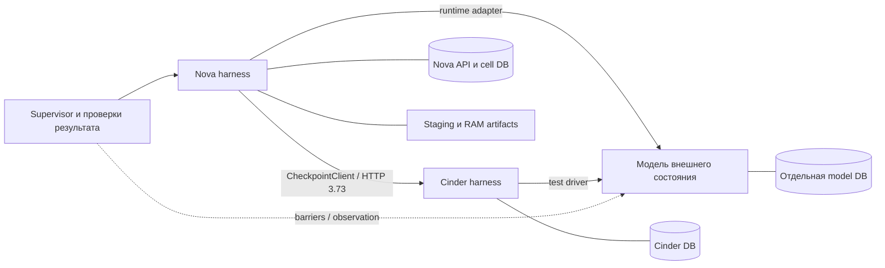

# L1: сквозная проверка Nova/Cinder без СХД

Дата: 2026-10-08. Статус: **согласована пользователем; реализация L1 не начата**.

Пользователь согласовал направление: продолжать проверку общей логики
checkpoint без доступа к каким-либо СХД и подтвердил эту спецификацию.
Устройство тестового комплекта и критерии приёмки заданы ниже.
[План реализации](../plans/2026-10-08-checkpoint-local-integration-l1.md)
согласован отдельно; исполнение Native начато.

## 1. Цель и результат

Проверить единую цепочку Nova API → coordinator/executor → настоящий Cinder
HTTP API → Cinder workers → программная модель внешних эффектов. После
принудительной остановки процесса продолжение должно опираться на сохранённые
журналы и наблюдение исходного эффекта.

Результат L1 — воспроизводимый локальный тестовый комплект с evidence:

- create A → create B → revert A → revert B → revert A, затем delete B/A;
- независимые маркеры моделируемой RAM и каждого из двух томов;
- потеря ответа и остановка Nova/Cinder в определённых точках выполнения;
- отсутствие повторного внешнего эффекта для уже отправленного шага;
- удержание guards, locks и соответствующих квот при unknown;
- отсутствие reconnect/unpause после частичного revert.

Успех L1 означает проверку этой программной модели и интеграции компонентов.
Он не устанавливает production profiles, не квалифицирует vendor API и не
доказывает фактическое восстановление памяти KVM. Наличие Linux/KVM, NAS или
СХД не предполагается. Для исполнения потребуется одноразовая Linux-среда;
её готовность проверяется отдельным preflight, а не выводится из старых логов.

## 2. Зафиксированная база и уже существующие проверки

При подготовке документа проверены HEAD и чистота обоих рабочих деревьев:

| Компонент | Commit | Исторический комплект |
|---|---|---|
| Nova N2 | `ce3c1c474b8fd04b6223cf8cf3af7079345d14b2` | N2 (`deliverables/nova-checkpoint-executor-n2/README.md`) |
| Cinder C1.1 | `d065a55cbe5cb8cd59489752846a41145d72bd27` | C1.1 (`deliverables/cinder-checkpoint-continuation-c11/README.md`) |

Старые результаты остаются историческими: подготовка этой спецификации не
включала повторного запуска тестов. Границы доказательств сохранены в
N2 VALIDATION (`deliverables/nova-checkpoint-executor-n2/VALIDATION.md`)
и C1.1 VALIDATION (`deliverables/cinder-checkpoint-continuation-c11/VALIDATION.md`).

| Наблюдение по текущим исходникам | Пробел L1 |
|---|---|
| `CheckpointV2TestCase` подключает `Backend` как Cinder client и к executor, и к attachment coordinator | Полный workflow должен использовать `CheckpointClient` с реальным Cinder HTTP |
| `CinderContinuationContractTest` проверяет настоящий Cinder subprocess, но загружает Nova operation/intent из словарей | В сквозном тесте эти данные должны читаться штатными loaders из Nova SQL/OVO |
| `restart_api_and_workers()` создаёт новый worker с `worker.driver = endpoints[0].driver` | Состояние внешних эффектов должно пережить новый интерпретатор без старого объекта driver |
| Nova `Backend` хранит одно `disk_bytes` для всех ресурсов | Данные и ожидания должны индексироваться по volume UUID |
| Есть отдельный `os._exit` тест публикации RAM artifact | Он не заменяет остановку всей Nova/Cinder тестовой цепочки |
| `run-gate.sh` содержит `/work`, имена прежних контейнеров и готовые venv | Нужен самостоятельный preflight и параметризованный запуск |

Исходники: Nova fixture (`work/nova-checkpoint-executor/nova/tests/fixtures/checkpoints_v2.py`),
HTTP contract test (`work/nova-checkpoint-executor/nova/tests/functional/test_checkpoint_cinder_contract.py`),
Cinder fixture (`work/cinder-checkpoint-continuation/cinder/tests/functional/checkpoint_continuation_fixture.py`),
Cinder fake driver (`work/cinder-checkpoint-continuation/cinder/tests/unit/checkpoints/fake_driver.py`),
POSIX crash test (`work/nova-checkpoint-executor/nova/tests/functional/test_checkpoint_store.py`).

## 3. Выбранный подход

| Подход | Что даёт | Решение |
|---|---|---|
| Дополнить существующие in-process fixtures | Минимум подготовки; больше вариантов ошибок | Полезно как вспомогательная регрессия, но не закрывает потерю памяти процесса |
| Отдельные процессы Nova, Cinder и модели, постоянные тестовые БД | Настоящий HTTP между компонентами, воспроизводимая остановка процесса, независимое состояние эффектов | Выбран для L1 |
| Поднимать весь OpenStack с настоящими Keystone, RabbitMQ, Neutron и KVM | Более широкая проверка runtime | Отдельный последующий этап; слишком много новых переменных для указанных пробелов |

В первом L1 API/conductor/compute работают внутри одного процесса Nova harness,
а API/scheduler/volume workers — внутри одного процесса Cinder harness.
Внутренний oslo RPC сохраняет serializer и тестовый transport; это не проверка
RabbitMQ, доставки сообщений между ОС-процессами или отдельного отказа compute
при продолжающем работать conductor. Остановка группы так и обозначается
в сценарии: `nova_group` либо `cinder_group`.

## 4. Компоненты и размещение

Будущий самостоятельный комплект: `work/checkpoint-local-integration/`.
Он использует закреплённые Nova/Cinder checkouts в двух отдельных Python
environments. Поддерживающий код расположен в `checkpoint_lab/`, его тесты —
в `tests/`, инструкции — в одном `README.md`. Точное разбиение файлов задаст
план реализации. Одновременный import Nova и Cinder в одном интерпретаторе
не требуется.

Supervisor управляет только дочерними процессами своего запуска, сроками
ожидания, одноразовыми fault barriers и сбором evidence. Команды сценария
проходят через Nova API. Recovery вызывает настоящий `RecoveryManager`;
Cinder reconciliation — настоящий C1.1 manager. Test-only control channel
может запустить этот обработчик и вернуть диагностику, но не может изменять
operation status, journal, quotas или результат внешнего эффекта.

Nova harness сохраняет действующие API/policy/schema проверки, coordinator,
quota ledger, OVO, executor, runtime, attachment coordinator и файловые
store/staging компоненты. `CheckpointClient` использует штатные
`operation_loader` и `intent_loader`; подставляются только session/service auth
для тестового endpoint. `SimpleNamespace` вместо durable операции запрещён.

Cinder harness сохраняет настоящий router, auth middleware, SQL, service
continuation, worker и проверки ownership. Только storage driver и ответчик
проверки токена тестовые. Его connection information согласуется с volume UUID
и attachment state; os-brick I/O моделируется.

Профили runtime/store/staging и сведения Neutron синтетические и вводятся
только в test adapter. Они маркируются `test-only` в отчёте, не записываются
в production allowlist и не поставляются как разрешающие deployment profiles.
Модель не предоставляет endpoints Huawei/TATLIN и не объявляет их совместимость.

## 5. Постоянное состояние и повторный запуск

Каждый case получает новый `run_id`, каталог состояния и manifest неизменных
идентификаторов: deployment, project, actor, service user, instance, host,
ports, два volume UUID, backend IDs и database locations. Исходные UUID должны
совпадать в Nova и Cinder; поля не исправляются после начала сценария.

Nova API DB, cell DB и Cinder DB — отдельные файловые SQLite базы; файловая
БД модели независима от них. Схемы сервисов создаются штатными миграциями
ровно один раз. Для данного L1 достаточно одной действующей cell; существующая
двухклеточная SQL-регрессия остаётся отдельным gate. Здесь не заявляется новая
проверка межклеточного отказа.

Режим bootstrap создаёт schema, начальные service/instance/volume/attachment
rows и manifest. Режим resume открывает те же файлы, проверяет manifest и
версии; не пересоздаёт schema, не очищает строки, не генерирует новые resource
UUID и не восстанавливает journals из копии в supervisor. Наследовать
`TestCase.setUp()` с очисткой БД в resume нельзя.

Для SQLite включается синхронная запись; выбранные journal/synchronous режимы
фиксируются в evidence. Соединения открываются заново в каждом процессе.
Транзакции модели не объединяются с транзакциями Nova/Cinder. Такая схема
проверяет process crash на локальном диске, но не power-loss durability и не
конкурентность production СУБД.

Тестовая RAM, состояние domain и диски принадлежат модели внешней системы.
Остановка Nova/Cinder не стирает их. Save artifact создаётся через настоящий
N2 файловый путь, но содержит ограниченные синтетические данные. Чтение модели
supervisor-ом не может быть использовано production recovery как дополнительное
доказательство, которого нет в обычном протоколе.

## 6. Модель эффектов и независимая проверка данных

Модель хранит данные отдельно для каждого volume UUID; snapshot содержит
исходный volume UUID и неизменяемые bytes. Domain state и RAM bytes отдельны
от дисков. Начальные значения различаются, например `A:ram`, `A:disk-1`,
`A:disk-2`; значения B также попарно различны. Ожидаемая таблица задаётся
сценарием до запуска, а не выводится из ответа продукта.

Тестовый native effect привязан к action, resource IDs и durable step UUID.
Отдельно учитываются число входящих execute-вызовов и число совершённых
эффектов: скрытое устранение дублей моделью не должно делать неисправный
клиент зелёным. Повтор execute уже отправленного шага фиксируется как нарушение;
exact replay REST-запроса сам по себе допустим, если не приводит к такому вызову.
Чужой resource либо другой payload под прежним key отклоняется до эффекта.

В модели изменение данных и completion record фиксируются одной собственной
транзакцией. Это явная семантика синтетического backend, а не обещание
атомарности массива. Перед commit принудительная остановка оставляет прежнее
состояние; после commit query может подтвердить исходный результат. Сценарии
также включают неизвестное/недоступное наблюдение и отсутствие completion
record. Отсутствие записи само по себе не возвращает `failed_no_effect`.

Query может создавать диагностическое событие чтения, но не меняет данные,
эффекты, completion records или счётчик execute. Native runtime query Nova
сохраняет более строгие правила N2: моделируемый stopped domain либо существующий
RAM artifact без штатной receipt не превращают unknown в success.

Для смены состояния A на B используется отдельная команда guest-model write,
разрешённая только в RUNNING. Она пишет RAM/диски и попадает в trace; не выдаётся
за checkpoint effect и не меняет journals Nova/Cinder.

## 7. Управляемые отказы

Fault barrier адресуется по `(run_id, scenario, phase, action, resource)` и
срабатывает один раз. Supervisor ждёт подтверждения достижения конкретной
границы, затем останавливает выбранный процесс, ожидает его завершения и
запускает новый интерпретатор. PID/launch UUID до и после записываются в trace.
Случайные задержки не используются как доказательство попадания в окно сбоя.

Границы для Cinder: journal claim до driver call; commit эффекта модели до
ответа worker; завершение worker до доставки HTTP ответа. Для Nova: intent до
runtime call; внешний save/restore/unpause до локальной receipt; receipt до
наблюдения завершения шага. Test instrumentation допускается на границе вызова,
но не подменяет результат production проверки и не выполняет её пропущенную часть.

Для потери HTTP ответа используется loopback test proxy с наблюдаемым upstream
ответом и обрывом downstream. Он позволяет зафиксировать, что запрос достиг
Cinder, не меняя `CheckpointClient._fetch`. Proxy не повторяет запросы.

Timeout case означает неуспешное/незавершённое испытание. Он не снимает guard,
не обнуляет квоту и не очищает journal. Supervisor завершает собственные
процессы, сохраняет evidence и завершает запуск с ненулевым exit code.

## 8. Обязательные сценарии

| ID | Сценарий | Проверяемый результат |
|---|---|---|
| L1-01 | A/B, revert A → B → A, delete B/A через Nova API | RAM и оба диска соответствуют выбранной точке; server/volume/port identity сохранены; удаление B сохраняет A и текущие данные |
| L1-02 | Запрос reserve принят Cinder, ответ потерян; остановка и resume Nova | Та же operation и grant; отсутствует повторный reserve из background; continuation работает с service identity |
| L1-03 | Reserve не дошёл до Cinder | Recovery остаётся guarded; только exact user API replay может доставить исходный запрос, без второго принятого operation |
| L1-04 | Остановка Cinder после claim, до native effect | Отсутствующая completion не считается no-effect; query без повторного execute, locks сохраняются |
| L1-05 | Commit snapshot/revert/delete в модели, затем остановка Cinder до ответа | Новый процесс обнаруживает исходный effect через query; execute/effect count не увеличивается; допустимое продолжение завершается |
| L1-06 | Потеря Nova результата после штатной durable runtime receipt | Новый Nova процесс подтверждает эффект штатным query и продолжает; второго save/restore/unpause нет |
| L1-07 | Runtime effect выполнен, Nova остановлена до записи receipt | Unknown, удержание guards/квот, отсутствие нового runtime effect; сведения supervisor не используются для обхода |
| L1-08 | Первый том reverted, второй остаётся unknown | Ни reconnect, ни unpause; на дисках видна смешанная модель данных, но domain не RUNNING; защита обоих томов сохраняется |
| L1-09 | Ответ attachment update/create потерян после штатного результата, затем restart | Исходный child/attachment request восстанавливается по прежнему key; нет повторного export/connection effect; volume mapping верен |
| L1-10 | Исходный user token признан истёкшим, затем restart | Сохранённый grant работает со свежей service identity; чужие project/service отклоняются; expiry не сбрасывается restart-ом |
| L1-11 | Artifact cleanup не завершён либо отсутствует доказательство завершения writer | Нельзя удалить занятой artifact или вернуть соответствующую квоту; после штатно доказанного cleanup освобождение однократное |
| L1-12 | Повтор REST-запроса и прежний key с изменённым payload | Exact replay сохраняет operation ID; изменённый запрос отклонён до I/O |

Положительные post-commit сценарии требуют именно предусмотренного контрактом
completion proof. У Cinder attachment и runtime разные правила query: если
выбранное окно не даёт такого proof, ожидается сохранение unknown, а не
искусственное «восстановление». L1-09 выполняется после durable attachment
result; окно до него проверяется как unknown отдельным вариантом этого case.

L1-05 параметризуется по трём действиям. L1-06/07 — по save, restore_paused и
unpause. Матрица запланированных case IDs разворачивается до исполнения,
чтобы пропавший вариант не мог считаться успехом.

## 9. Проверки результата и защита от ложного GREEN

По каждому case проверяются одновременно REST result, service journals,
model data, native execute/effect counters, guards/locks, постоянные и временные
квоты, attachments, domain state и hashes артефактов. Значение expected quota
определяется фазой: unknown не требует произвольного положительного значения
всех counters, но исключает возврат ещё принадлежащего операции reservation.

Сборщик читает committed SQL/OVO и модель без исправления строк. Trace содержит
source, последовательность внутри процесса, correlation IDs, launch UUID и
границы commit/barrier; межпроцессный порядок задаётся подтверждёнными barriers,
а не сравнением настенных часов.

Обязательные отрицательные контроли самого комплекта:

1. Поменять местами значения двух дисков в тестовой модели — marker check падает.
2. Вызвать повторный execute — проверка считает оба обращения и падает.
3. Выполнить query, меняющий модель, — проверка read-only query падает.
4. Потерять case outcome, barrier acknowledgement или exit status — полный
   запуск не может завершиться с PASS.
5. Попытаться resume с отсутствующей БД либо изменёнными resource IDs — запуск
   завершается ошибкой, без reseed.

Постоянство самой модели проверяется отдельным component test: завершить её
интерпретатор до и после commit, запустить новый и сверить bytes, snapshots,
записи результатов и счётчики. Идентификаторы шагов Nova и Cinder разделены
namespace-ом источника; одинаковая строка UUID из другого контура не является
тем же эффектом. Этот test проверяет модель, а не заменяет L1-04/05/07.

Это test-only controls; они не вносят дефект в production code и не включаются
в обычный положительный прогон.

## 10. Запуск и воспроизводимость

Комплект предоставляет `preflight` и `run`. Входы: пути двух checkouts и Python
interpreters, новый output directory, scenario selection и deadline. Пути
передаются явно; preflight проверяет pinned commits/trees, отсутствие tracked
diff, Python 3.11, imports/dependencies, Linux process controls и доступность
только собственного временного каталога. При mismatch запуск останавливается.

В README будет отдельная подготовка одноразовых Linux environments по
закреплённым public requirements и constraints. Сохраняются версии образа,
Python и dependencies; private `storage_client` не имитируется. L1 не зависит
от этого SDK; широкая историческая регрессия сохраняет своё документированное
исключение. Готовая `.venv` или запущенный контейнер прежней сессии не требуются.

Все endpoints — loopback и случайные свободные порты внутри одноразовой
Linux-среды. Комплект не принимает production endpoint/credentials и не
устанавливает соединений с реальными массивами. Test tokens детерминированно
помечены; реальные auth headers не собираются. Каждый run создаёт новый
каталог; resume применяется только внутри управляемого case.

Exit codes: `0` — все выбранные cases и обязательные проверки завершены;
`1` — failed, timed out, crashed либо incomplete case; `2` — неверный input
или preflight failure. Subset-run может иметь exit 0, но отчёт обязательно
указывает `suite_complete=false`, пока не выполнена полная матрица.

Минимальный evidence: input manifest и source hashes; environment inventory;
полный ожидаемый/фактический case inventory; raw process logs; barriers и
effect trace; безопасные journal projections; hashes файлов артефактов;
`results.json` и `SHA256SUMS`. Итоговый тип отчёта —
`local_simulated_integration`, с `production_qualified=false` и
`hardware_qualified=false`. Он не подаётся как положительный V1 report.

## 11. Границы изменений и критерий завершения L1

Реализация добавляет самостоятельный тестовый комплект. Исторические bundles,
Nova/Cinder production modules, миграции, policy, API/RPC версии и dependency
pins остаются базой. Helpers можно переиспользовать только без destructive
fixture setup. Production bug, обнаруженный новым сценарием, фиксируется
воспроизводимым RED и отдельным предложением исправления; expectations ради
GREEN не ослабляются.

L1 завершён, когда:

- объединённый lifecycle и вся развёрнутая fault matrix прошли;
- для crash cases доказаны новый интерпретатор, сохранённые идентификаторы и
  отсутствие reseed; состояние внешней модели не взято из старого Python object;
- отрицательные контроли выявляют предназначенные нарушения;
- повтор полного запуска в свежем output directory проходит по инструкции;
- existing affected regression остаётся без новых failures, skips и xfails;
- результаты содержат явную границу simulated/runtime и проверяемые hashes.

Число будущих тестов заранее не объявляется результатом. Не выполненные cases
остаются pending/failed в отчёте. Произвольное увеличение объёма регрессии
вместо закрытия этой матрицы не является критерием завершения.

## 12. Последовательность после review

Подробный план реализации должен сохранить следующие зависимости:

1. Bootstrap/resume и model persistence с отрицательными контролями.
2. Один полный двухтомный lifecycle через настоящий Nova → Cinder HTTP.
3. Barriers, process crashes и response-loss cases с разными допустимыми proofs.
4. Полная матрица, affected regression, повтор запуска из чистой среды и пакет.

Этот дизайн не является отчётом исполнения L1. Для него выполнена сверка локальных
исходников и самопроверка границ, идентификаторов, crash/replay семантики и
критериев результата. Корень workspace не является Git repository; файл
размещён в существующем `docs/superpowers/specs/`, без создания нового Git repo.
