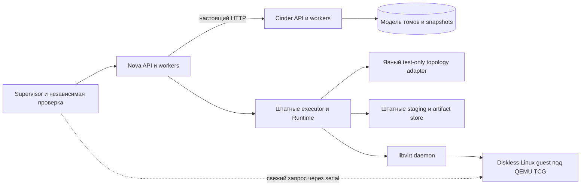

# L1-R: настоящая RAM QEMU/TCG в локальной цепочке Nova/Cinder

Дата: 2026-10-09. Статус: **согласована пользователем; реализация не начата**.

[План реализации](../plans/2026-10-09-checkpoint-l1-real-ram.md) подготовлен
для отдельной проверки перед исполнением.

Пользователь подтвердил продолжение локальной работы без стенда: подключить
проверенный QEMU/TCG к L1 и проверить сбои операций и потерянные ответы.
Этот документ конкретизирует расширение после чтения текущих исходников.
Это архитектурное расширение тестового комплекта, а не расширение поддержки
production Nova. Документ размещён рядом с предыдущими спецификациями;
корень рабочего каталога не является Git-репозиторием.

## 1. Цель и граница результата

Проверить, что настоящие Nova checkpoint executor, runtime journal, staging
и artifact store работают с файлом сохранённой RAM настоящей Linux-ВМ,
а recovery после потери процесса соблюдает существующие правила completion.
Операции запускаются через Nova API и проходят существующий Cinder HTTP API.

ВМ работает под QEMU/TCG. Диски Cinder, подключения os-brick, Neutron,
профили файловых систем и проверка токенов остаются тестовыми границами L1.
Гость не имеет дисков и сетевого интерфейса; данные моделируемых томов
проверяются отдельно от RAM. Это не проверка согласованности RAM с реальным
гостевым блочным I/O.

Отчёт нового режима получает отдельный scope `local_real_ram_simulated_storage`:

- `ram_runtime=libvirt_qemu_tcg`, `guest_arch=aarch64`, `kvm=false`;
- `storage_runtime=persistent_test_model`, `topology_admission=test_fixture`;
- `production_topology_validated=false`, `disk_ram_consistency_validated=false`;
- `hardware_qualified=false`, `production_qualified=false`.

Успех L1-R не заменяет V1, квалификацию KVM, NAS, Dorado или TATLIN.
Новые production profiles, endpoints, credentials и изменения Nova/Cinder
в этот этап не входят.

## 2. Проверенная база и обнаруженные ограничения

| Компонент | Commit |
|---|---|
| L1 | `02261dd0d4a28f525535a95cc1e7f68a1d34e906` |
| Nova | `6d55009fae5eb55adb156e13835dd66240488f84` |
| Cinder | `d065a55cbe5cb8cd59489752846a41145d72bd27` |

Рабочие деревья этих компонентов проверены: чистые. Старые результаты
L1 146/146 и 24/24 относятся к моделируемому runtime; в ходе подготовки
данной спецификации эти тесты повторно не запускались.

Предшествующий RAM-эксперимент (`deliverables/qemu-libvirt-ram-spike-20261009/artifact-validation.json`)
прошёл 18 проверок: метка, счётчик и 8 МиБ данных пережили save/restore,
исходный QEMU завершился, холодная загрузка сбросила данные. Сохранённый
образ имеет размер 56 601 841 байт. Экспериментальный код не является
готовым адаптером L1.

| Наблюдение по текущему коду | Следствие для L1-R |
|---|---|
| `Topology._inspect` требует `domain type=kvm`, x86_64/BIOS, `observed.kvm=True`, соответствие настоящих устройств BDM/VIF | ARM/TCG нельзя допустить через production topology без смены её контракта |
| `ModelRuntime.checkpoint_save` пишет JSON с моделируемой RAM | Этот путь не используется для RAM в новом режиме |
| `Runtime.save/query` наблюдает SHUTOFF и XML домена после save | Нужен persistent domain; transient domain из spike недостаточен |
| `Guest.checkpoint_set_marker` использует LIVE и CONFIG | Метка должна сохраняться в настоящем persistent domain |
| `StagingStore` передаёт путь `/proc/<pid>/fd/<dirfd>/.../data` | Доступ daemon к этому пути нужно проверить до интеграционной матрицы |
| L1 задаёт `LIMIT=1 MiB` и flavor 512 MiB | Новому режиму нужны собственные лимиты и flavor, согласованный с гостем |
| Installer L1 требует native libvirt и libvirt-python 11.10.0 | Нельзя молча заменить их библиотекой 9.0.0 из spike |

Источники: L1 adapters (`work/checkpoint-local-integration/checkpoint_lab/nova/adapters.py`),
L1 runtime (`work/checkpoint-local-integration/checkpoint_lab/nova/runtime.py`),
Nova topology (`work/nova-checkpoint-recovery-fix/nova/virt/libvirt/checkpoints/topology.py`),
Nova runtime (`work/nova-checkpoint-recovery-fix/nova/virt/libvirt/checkpoints/runtime.py`),
L1 installer (`work/checkpoint-local-integration/tools/prepare_environments.py`).

## 3. Выбранное устройство

Рекомендуется отдельный явно выбранный режим существующего L1 в изолированной
ветке. Режим L1 по умолчанию, его 24 case IDs, source pins и формат старого
отчёта сохраняются. L1-R имеет собственные manifest, inventory и verifier
ветвление по версии/schema и scope; смешивание двух режимов отклоняется.

Рассмотрены альтернативы:

| Подход | Решение |
|---|---|
| Добавить ARM/TCG в production topology Nova | Вне задачи: меняет область поддерживаемой конфигурации продукта |
| Выдавать синтетический KVM XML за XML реального гостя | Отклонён: скрывает расхождение между наблюдением и runtime |
| Явный test-only topology adapter и настоящий libvirt runtime | Выбран: сохраняет фактические XML/RAM и честную границу admission |

### 3.1 Настоящий runtime

Адаптер использует libvirt connection и настоящий `nova.virt.libvirt.guest.Guest`
для state, XML, metadata, save, stop и resume. Restore выполняет
`restoreFlags(..., VIR_DOMAIN_SAVE_PAUSED)`, чтение XML образа —
`saveImageGetXMLDesc`. Нельзя заменять результаты этих вызовов данными модели.
Штатный `nova.virt.libvirt.checkpoints.runtime.Runtime` не меняется.

Гость определяется один раз как persistent domain, UUID совпадает с
`instance_uuid` case. Имя, UUID, socket, kernel/initramfs и пути принадлежат
данному run. После перезапуска `nova_group` адаптер повторно открывает
connection и находит существующий домен; не выполняет define/start,
не заполняет RAM и не создаёт новые resource UUID.

QEMU и libvirt живут вне процесса `nova_group`, поэтому SIGKILL этой группы
не завершает их. Отсутствующий домен в режиме resume — ошибка наблюдения,
а не повод заново загрузить гостя. Cleanup принадлежит supervisor и выполняется
только после фиксации результата case.

### 3.2 Test-only topology

Это отдельный компонент test harness с интерфейсом `inspect/current_xml/restore_xml`,
вводимый через существующий конструктор Runtime. Он не monkey-patch-ит
production `Topology._inspect` и не объявляет `kvm=True`.

Он проверяет настоящие UUID, состояние, постоянство domain, ARM/TCG machine/CPU,
объём RAM, отсутствие дисков/сетевых интерфейсов и неизменность kernel/initramfs.
Canonical XML identity строится штатной функцией `guest_identity` по реальному
XML. Проверка saved/current identity при restore остаётся обязательной;
метаданные checkpoint добавляет штатный Runtime.

DB fingerprint сохраняет настоящие Nova/Cinder UUID и manifest модели томов.
Сведения BDM/VIF в этой модели проверяются отдельно; они не объявляются
устройствами гостя. Runtime fingerprint включает реальную XML identity,
test profile identity, immutable boot inputs и закрытый режим L1-R.
Нельзя возвращать произвольный fingerprint только ради прохождения binding.

Отдельный отрицательный тест подтверждает, что неизменённый production
Topology по-прежнему отклоняет фактический ARM/TCG domain.

### 3.3 RAM и модель дисков

Гость получает 256 МиБ RAM и 1 vCPU; соответствующий flavor задаётся только
в новом режиме. Его initramfs содержит минимальную проверочную программу,
но не значения A/B. После загрузки supervisor через serial передаёт
случайную метку, создаёт 8 МиБ детерминированных данных и меняет счётчик.
Изменение состояния A/B допускается только у RUNNING-гостя.

Независимый запрос содержит новый challenge. Ответ включает метку, счётчик,
проверку всех байтов и checksum, который supervisor вычисляет отдельно.
При PAUSED/SHUTOFF supervisor не запускает гостя ради чтения RAM. В этих
состояниях отчёт содержит фактическую недоступность console-измерения,
состояние domain и артефакты; это не PASS на основании ожидаемого маркера.

В режиме L1-R модель не выполняет save/restore/unpause и не служит источником
RAM. Она продолжает хранить данные двух независимых томов, snapshots,
attachments и audit. Новое наблюдение объединяет факты из двух источников
с отдельными полями `ram_guest` и `storage_model`. Результат восстановления
RAM никогда не выводится из model DB или checkpoint journal.

Лимит одного RAM artifact для нового режима — 384 МиБ. Верхний бюджет каждого
case-local staging/store профиля — 1536 МиБ; allocation unit — 4096 байт,
metadata budget — 256 КиБ. Одновременные workspaces укладываются в этот бюджет.
Лимиты admission, writer и simulated quota observer согласуются между собой.
Превышение лимита — ошибка с сохранением evidence; успешное восстановление
не отменяет проверку расхода и освобождения квот. Прежний лимит L1 не меняется.

## 4. Локальная среда и первый обязательный gate

Чтобы сохранить зависимости L1, предлагается использовать два одноразовых
контейнера: Rocky/Python 3.11/native libvirt 11.10.0 для Nova/Cinder и образ
Debian/QEMU 7.2.22/libvirt daemon 9.0.0 из spike для гостя. Контейнеры имеют
общий PID namespace и ограниченный общий Linux volume с одинаковыми
абсолютными путями. Libvirt доступен через принадлежащий запуску UNIX socket;
TCP libvirt и внешние endpoints не используются. Контейнер runtime запускается
с `--init`; daemon/QEMU и клиент работают с согласованными UID/GID.

Образ spike проверен как доступный:
`sha256:b401f226777150df23ca3fab57f21a262316df0f4618e2a4c5355f264bbf2d25`.
Предыдущий контейнер L1 существует, но остановлен. Его содержимое и старые
venv не считаются свежей проверкой и не изменяются для нового режима.

Совместная работа клиента libvirt 11.10.0 с daemon 9.0.0 и доступ daemon к
N2 pinned paths **ещё не проверены**. Первый gate до интеграционных сценариев:

1. Сверить image IDs, source pins, UID/GID, PID/mount namespaces и версии
   client library, Python binding, daemon, QEMU, kernel и initramfs.
2. Создать принадлежащий probe persistent domain; использовать тот же UID,
   UNIX socket и форму pinned path, что будет у Nova.
3. Выполнить metadata LIVE/CONFIG → save → наблюдение SHUTOFF и inactive XML
   → saved XML → restore PAUSED → наблюдение PAUSED → resume.
4. Проверить RAM свежим console challenge, завершение старого QEMU,
   новый QEMU, cold-boot negative control и bounded cleanup.
5. Проверить вход в настоящий Nova Runtime с этими параметрами и доступность
   POSIX staging/store при неизменных зависимостях L1.

До этого gate среда L1-R не называется готовой. При несовместимости нельзя
ослаблять pins, подменять путь `/proc` копированием образа, расширять production
topology или выдавать marker за completion. Следует сохранить конкретную
ошибку и пересмотреть только способ размещения среды отдельным изменением
этой спецификации. Это разрешает неопределённость среды до большой реализации.

Во время case сеть контейнеров ограничена локальным обменом; внешние сетевые
доступы нужны только при отдельной подготовке зависимостей. SQLite и RAM
артефакты находятся на Linux volume, не на macOS bind mount. Образам не нужны
KVM, privileged mode, физические СХД или изменение сетевых настроек хоста.

## 5. Матрица приёмки L1-R

Первый полный inventory содержит **13 сценариев**. Нет автоматического
заявления о выполнении всех 24 старых L1-сценариев с настоящей RAM.

| IDs | Число | Действие и обязательный результат |
|---|---:|---|
| `L1R-01` | 1 | A → create A → B → create B → revert A/B/A → delete B/A; RAM проверяется через guest, два тома — через model; UUID и правила освобождения ресурсов сохранены |
| `L1R-02.save`, `.restore_paused`, `.unpause` | 3 | SIGKILL `nova_group` после настоящего эффекта до receipt; после resume операция остаётся unknown, повторного native вызова нет, guards/квоты удержаны; состояния SHUTOFF/PAUSED/RUNNING соответственно |
| `L1R-03.save`, `.restore_paused`, `.unpause` | 3 | SIGKILL после durable receipt до наблюдения завершения; новый процесс использует receipt и штатные проверки, исходный эффект повторно не выполняется |
| `L1R-04.snapshot`, `.revert`, `.delete_snapshot` | 3 | Proxy получил настоящий ответ Cinder, но оборвал его доставку Nova; recovery query-only, число мутаций каждого ресурса не увеличено; в завершающихся RUNNING-точках проверяется настоящая RAM |
| `L1R-05.partial_revert` | 1 | Частичный revert модели двух томов; гостевой domain остаётся SHUTOFF, restore/unpause и host reconnect не выполняются |
| `L1R-06.live_writer` | 1 | Управляемая задержка writer после native save до окончания его владения workspace; cleanup не удаляет живой workspace, после завершения/остановки владельца действует штатный протокол |
| `L1R-07.cold_boot_control` | 1 | После завершения отдельного успешного lifecycle и освобождения checkpoint guards обычный новый boot того же тестового domain теряет RAM marker/counter; kernel/initramfs неизменны |

Fault ACK привязан к run, case, child, action, resource и точной границе.
SIGKILL применяется только к процессу группы этого запуска после ACK. Перед
resume фиксируются exit и новая process identity. Произвольный sleep не
считается доказательством попадания в fault window.

Каждый вход в native mutation журналируется отдельно от успешного ответа.
Test adapter не выполняет скрытую дедупликацию: повторный вызов должен быть
виден verifier и проваливать case. QEMU PID может измениться при штатном
restore; состояние и completion child нельзя устанавливать только по PID,
наличию save image, metadata marker или отсутствию QEMU.

Query может добавлять audit чтения, но не изменяет RAM, данные томов,
completion records, native execute counts или ownership. Утрата результата
вызова с отсутствующей штатной receipt не превращается в success даже при
правдоподобном состоянии гостя. Эти правила следуют существующему Runtime.

## 6. Evidence и проверка отчёта

Новый verifier сохраняет существующие SQL/WAL, schema, pins, loaders,
barrier/restart и quota проверки L1 там, где они относятся к общему workflow.
К ним добавляются:

- реальные live/inactive/saved domain XML и UUID;
- QEMU argv, PID/start identity до save, после restore и при контрольном boot;
- записи входа/выхода native calls с child/action/resource и fault ACK;
- serial challenge/response transcripts, ожидаемые метки и независимый checksum;
- бинарные RAM artifacts, их размер/SHA256 и штатная связь с artifact rows;
- полный инвентарь client/daemon/container/boot-input версий;
- отдельные результаты наблюдения guest RAM и model storage;
- точный scope и все отрицательные qualification flags.

Проверка сохранённых данных не вызывает libvirt мутаций и не выполняет recovery.
Raw transcripts сверяются с результатом; manifest отражает все обязательные
case IDs до запуска. Missing case, пропущенный fault ACK, неполная очистка,
таймаут или пропуск обязательного доказательства дают fail/incomplete.

Отдельные corruption controls должны отклонять подменённые scope/kvm flags,
RAM checksum, challenge, UUID, порядок ACK/exit/resume, отсутствие native
dispatch, повтор mutation и заменённый RAM artifact даже после пересчёта
общего SHA manifest. Checks=true без соответствующих raw evidence недостаточно.

Манифест контрольных сумм обнаруживает повреждение; внешней криптографической
аттестацией факта запуска он не является.

## 7. Изменяемые области и критерий завершения

Изменения ограничены отдельной веткой тестового репозитория L1:
выбор режима/manifest, libvirt adapter, test-only topology, guest probe,
scenario/oracle/evidence, локальная среда и документация. Имеющийся throwaway
код spike используется как исследовательский материал; его нельзя объявить
готовым production-компонентом простым копированием.

Завершение требует:

1. Успешного environment gate из раздела 4.
2. Тестов новых контрактов и содержательных отрицательных controls.
3. Полного запуска 13/13 с проверкой отчёта из отдельной копии и проверкой
   hashes бинарных артефактов.
4. Регрессии общего кода и исходной L1-матрицы после изменений общего пути;
   старые исторические результаты не заменяют эту проверку.
5. Review изменений с устранением существенных замечаний, документации
   фактической среды/ограничений и воспроизводимой поставки из чистого commit.
6. Проверки неизменности Nova/Cinder pins и завершения всех принадлежащих
   запуску процессов/доменов. Merge, push и deployment не входят в этот этап.

Если будет обнаружен дефект продукта, тестовый комплект фиксирует его и
сохраняет RED evidence. Исправление Nova/Cinder и смена pin оформляются
отдельно; harness не обходит неуспешную продуктовую проверку.

## 8. Самопроверка спецификации

Проверены границы RAM/model storage, запрет маскировать TCG как KVM,
persistent-domain lifecycle, разделение topology admission и native effects,
правила unknown/receipt/query, 13 case IDs и ограничения наблюдения PAUSED.
Состав native environment обозначен как предложение с обязательным ранним
gate, а не как подтверждённо работающая интеграция. Реализация не начата:
спецификация согласована, план ожидает отдельного review.
