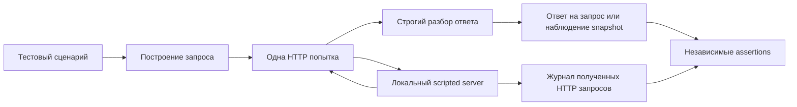

# Транспорт и обработка ответов Dorado для подготовки checkpoints

Дата: 2026-10-09. Статус: **согласована пользователем; реализация не начата**.

## 1. Цель и согласованные границы

Подготовить и проверить минимальный программный слой для запросов snapshot и
rollback Huawei Dorado без доступа к массиву. Пользователь подтвердил, что
оборудования нет, и согласовал переход от исследования к проектированию
транспорта и обработки ответов. Конкретная модель и firmware не назначаются.

Результат предлагаемого этапа D1-P — самостоятельный протокольный пакет с
проверками форм запросов, неоднозначных исходов и неполных ответов. Он позволит
обнаруживать ошибки нашей логики до появления устройства. Он не включает
готовый Cinder driver и не меняет действующий checkpoint admission.

Успех HTTP-запроса, корректность описания snapshot и успешное завершение
checkpoint являются разными фактами. Пакет представляет первые два и не
преобразует их в третий. Его metadata всегда содержит `supported=false`,
`production_qualified=false`, `hardware_qualified=false`.

## 2. Исходная база

Основание — [исследование Dorado без оборудования](../../../deliverables/checkpoint-patches-research-20261010/research/2026-10-08-dorado-without-hardware.md)
и [хеши исходников](../../../deliverables/checkpoint-patches-research-20261010/research/2026-10-08-dorado-without-hardware.evidence.json).
HTTP-вызовы сверены с официальным Huawei OpenStack Driver `v26.2.0`, commit
`bda6d13cd0147648e04da5479d678dc2e0541395`, каталог `Cinder/Epoxy`.
Это привязка к исходнику, а не выбор firmware будущего массива.

Существующие зависимости сохраняются:

| Компонент | Commit |
|---|---|
| Cinder C1.1 | `d065a55cbe5cb8cd59489752846a41145d72bd27` |
| Nova с исправлениями L1 | `6d55009fae5eb55adb156e13835dd66240488f84` |
| Стенд L1 | `02261dd0d4a28f525535a95cc1e7f68a1d34e906` |

В этой спецификации нет запуска прежних тестов или подтверждения готовности
среды. D1-P не импортирует Nova, Cinder, Huawei SDK или драйвер поставщика.

## 3. Варианты и предлагаемое решение

| Подход | Достоинство | Ограничение |
|---|---|---|
| Отдельный протокольный пакет | Узкая область проверки и отсутствие зависимости от OpenStack-среды | Интеграция с Cinder остаётся последующим этапом |
| Добавление клиента прямо в Cinder | Быстрая связь с driver hooks | До решения recovery пришлось бы смешать экспериментальный протокол с продуктовым контрактом |
| Расширение стенда L1 | Доступны процессные сценарии и настоящие OpenStack API | Избыточно для начальной проверки HTTP и JSON |

Предлагается первый подход. Будущая реализация размещается в самостоятельном
репозитории `work/dorado-checkpoint-protocol/`, Python 3.11, без сторонних
runtime dependencies. В текущем этапе проектирования этот каталог не создаётся.
Существующие checkouts и bundles остаются самостоятельными артефактами.

## 4. Компоненты и поток данных

| Компонент | Ответственность |
|---|---|
| `requests.py` | Типизированные операции, проверка входных данных, HTTP method/path/body |
| `transport.py` | Одна отправка, ограниченное чтение, фиксация ошибок; без retry и relogin |
| `responses.py` | JSON envelope, типы полей, identity и состояния snapshot |
| `types.py` | Неизменяемые структуры запросов и результатов |
| `tests/fixtures/` | Версионированные синтетические ответы и их происхождение |
| `tests/http_server.py` | Собственный loopback server, запись запросов и запрограммированные отказы |

Имена файлов являются границами ответственности; детальные задачи и команды
реализации появятся в отдельном плане после review этой спецификации.

## 5. Контракт запросов

Внутренний `RequestSpec` содержит `action`, `method`, `relative_path`,
канонические UTF-8 bytes JSON и ожидаемую identity. `operation_id` хранится
только как локальный идентификатор наблюдения. Он не добавляется в vendor body
или заголовки: семантика серверного idempotency key пока не подтверждена.
Транспорт повторно проверяет соответствие action, method, пути и body перед
соединением; вручную созданный несовместимый `RequestSpec` отклоняется.

Построитель предоставляет только семь операций:

| Action | HTTP |
|---|---|
| `create` | `POST /snapshot` с `NAME`, `DESCRIPTION`, `PARENTID` |
| `activate` | `POST /snapshot/activate` с `SNAPSHOTLIST` |
| `stop` | `PUT /snapshot/stop` с `ID` |
| `delete` | `DELETE /snapshot/{id}` |
| `rollback` | `PUT /snapshot/rollback` с `ID`, `ROLLBACKSPEED` |
| `get_by_id` | `GET /snapshot/{id}` |
| `get_by_name` | `GET /snapshot?filter=NAME::{name}&range=[0-100]` |

В этом пакете activate всегда содержит один ID в списке; групповые операции
не реализуются. `ROLLBACKSPEED` — integer 1–4, bool не принимается, как следует
из преобразования настройки в коде поставщика. Имена и description принимает
вызывающая сторона: пакет не придумывает новую схему именования snapshot.

Для локальных fixtures ID/name ограничены ASCII буквами, цифрами, `_` и `-`,
длиной 1–128; description — непустой UTF-8 текст до 1024 bytes без управляющих
символов. Это выбранные ограничения лаборатории, а не заявленные ограничения
Huawei API. Слеши, percent escapes, разделители query и CR/LF во входных
идентификаторах отклоняются до соединения. `operation_id` должен быть UUID.

Endpoint создаёт сам test runner: `http://127.0.0.1:<выделенный порт>`.
Лабораторный URL prefix устройства задаётся fixture и включается в evidence;
он не устанавливает путь API для неизвестного firmware. Входного параметра
для произвольного внешнего endpoint в CLI нет. Модуль transport также проверяет
числовой loopback адрес, порт и отсутствие credentials/query/fragment.

## 6. Отправка и ошибки транспорта

Транспорт использует Python 3.11 `http.client`, новую connection на каждую
попытку и ровно один вызов `request`. Соединение закрывается на всех исходах.
Не используются proxy из окружения, redirect, переключение адреса и login.
Тестовый `iBaseToken` передаётся в памяти и не попадает в evidence. Настоящая
аутентификация и TLS массива находятся за границей D1-P.

По [документации Python](https://docs.python.org/3.11/library/http.client.html)
socket timeout ограничивает блокирующие операции; он не является полным
дедлайном цепочки чтения. Поэтому socket timeout равен 3 секундам, а каждый
сетевой тест выполняется в собственном дочернем процессе с дедлайном 15 секунд.
Зависший процесс завершается его владельцем, тест считается failed и сохраняет
журнал. Успех библиотеки в пределах общего дедлайна не обещается.

Размер запроса и распакованного тела ответа ограничен 1 MiB. Поддерживаются
Content-Length и chunked framing; неоднозначное сочетание обоих, повторный
Content-Length, premature EOF и незавершённый chunk отклоняются. Content-Encoding
кроме identity не поддерживается. Наличие framing проверяется отдельно от JSON:
обрезанный ответ не должен стать корректным ответом из-за случайно полного JSON.

HTTP 2xx с валидным `error.code=0` означает лишь подтверждённый ответ API.
Redirect, HTTP error, nonzero vendor error и transport exception не означают
доказанного отсутствия эффекта. После начала сетевой попытки они сохраняются
как соответствующее наблюдение об ошибке; повторная мутация не отправляется.

Ошибки локального входа возвращаются до соединения как `local_rejected` с
`network_attempted=false`. Этот признак относится только к текущему вызову
и не говорит ничего о прежних вызовах с тем же UUID.

### Граница гарантии одной попытки

Отсутствие автоматического retry относится к **одному вызову транспорта**.
Пакет не обещает однократную отправку при повторном вызове клиентом или после
рестарта. Он не добавляет собственный durable journal или новый механизм
claims. Такой контроль при будущей интеграции остаётся в Cinder C1.1.
Тест, вызвавший транспорт дважды, не вправе ожидать дедупликацию со стороны D1-P.

## 7. Разбор ответов

JSON декодируется строго: обязательны UTF-8, один root object, отсутствие
duplicate keys, trailing content, NaN и Infinity. Эти проверки задаются явно:
стандартный [json decoder](https://docs.python.org/3.11/library/json.html)
по умолчанию допускает некоторые из этих форм.

Envelope требует object `error` с `code`, имеющим точный тип int; bool, float
и числовая строка не приводятся автоматически. Неизвестные дополнительные поля
могут сохраняться как наблюдение, но не влияют на решение. На ненулевом code
`data` не используется как успешный результат.

Предлагаются два независимых результата:

- `SubmissionObservation`: `local_rejected`, `api_acknowledged`,
  `api_error`, `http_error`, `unreadable_reply` или `transport_unknown`;
  diagnostic code, `network_attempted`, HTTP status при наличии и hash тела.
  Это не Cinder status.
- `SnapshotObservation`: проверенные ID/name/parent, нормализованное состояние,
  поля rollback и diagnostic codes. Результат чтения не устанавливает исход
  мутации, породившей наблюдаемое состояние.

Для create и get-by-ID успешный envelope дополнительно требует object `data`,
для get-by-name — list `data`. Для activate/stop/delete/rollback `data` может
отсутствовать: их `api_acknowledged` подтверждает только ответ API. Неправильная
форма обязательного `data` даёт `unreadable_reply`; наблюдение не создаётся.

Для признания identity согласованной требуются непустые строковые `ID`, `NAME`,
`PARENTID`, совпадающие с заданными ожиданиями; для create native ID извлекается
из ответа, а name и parent уже известны. `WWN` сравнивается, если ожидаемое
значение было передано; тогда отсутствие WWN является ошибкой. Полнота именно
этих полей в ответах будущего firmware пока является предположением fixtures.

Поиск по имени принимает только список из одной записи с точной identity. Пустой список
даёт `not_observed`, несколько записей — `ambiguous_identity`; ни один исход
не считается доказанным удалением или `failed_no_effect`. При полном окне из
100 записей результат обозначается `incomplete_listing`, независимо от
совпадений: D1-P не реализует и не предполагает полную pagination массива.

Для наблюдения состояния обязательны строковые `HEALTHSTATUS` и
`RUNNINGSTATUS`. Из подтверждённых констант используются normal `1`, active
`43`, rolling back `44`; прочие значения возвращают unrecognized state без
преобразования в терминальный результат операции. Snapshot с ненормальным
health не считается завершившим текущий откат.

`ROLLBACKRATE` принимается только как десятичная строка целого 0–100.
`ROLLBACKENDTIME` сохраняется как непустая строка без разбора в timestamp:
формат времени в целевой REST-спецификации не подтверждён. Отсутствующее поле
отмечается явно, а не сравнивается как `None` со строкой `'-1'`.
Значения rate=100 или endtime не `'-1'` остаются наблюдениями, которые могут
относиться к предыдущему rollback.

## 8. Связь с Cinder и отложенные решения

D1-P не экспортирует `get_checkpoint_capabilities` и не выдаёт Cinder-ответы
`succeeded`/`failed_no_effect`/`pending`. Преобразователь из наблюдений в
`checkpoint_query_operation` появится только после определения доказательства,
которое связывает native result с текущим step UUID и payload.

Create/activate и stop/delete вызываются по отдельности. Автоматического flow,
cleanup, отмены rollback и продолжения недостающей мутации нет. Read-only методы
выполняют только GET. Реальное восстановление между substeps остаётся отдельной
развилкой: подходящая серверная операция либо отдельно спроектированное
расширение durable continuation в Cinder.

Серверная идемпотентность, lookup по request key, срок хранения job history,
CoW/ROW, сохранение других snapshots и WWN здесь не предполагаются. Для D1-P
это границы результата; для полноценного адаптера они остаются обязательными
входными данными. Исходник драйвера не заменяет эти гарантии API.

## 9. Проверки и артефакты

Fixtures имеют обязательные `origin=synthetic`, source commit/path/lines,
назначение, перечень вымышленных значений и неподтверждённых предположений.
Полные ответы из массива не заявляются. Vendor driver не исполняется и его
внутренние тесты не засчитываются как проверки D1-P.

| Группа | Обязательные случаи и независимая проверка |
|---|---|
| Request builders | Все семь операций; точные method/path/body; неверные типы, speed, path injection и лишние поля отклонены до HTTP |
| Transport | Сервер получил запрос и оборвал ответ; timeout; 301/307/308; 401/403; 5xx; vendor error; журнал сервера подтверждает отсутствие автоматического повторного запроса |
| HTTP framing | Обрезанный Content-Length; незавершённый chunk; duplicate length; TE+CL; слишком большой ответ; trickle до дедлайна теста |
| JSON | Duplicate keys, invalid UTF-8, NaN, trailing content, отсутствующий error/code, bool/string code |
| Identity | Чужой parent/name/ID/WWN, пустой и неоднозначный поиск, полное окно 100 элементов |
| Rollback | Отсутствующие поля, неверные типы, progress вне диапазона; старый rate=100/endtime; текущий step отличается — терминальный Cinder success нигде не появляется |
| Read-only | GET-сценарии не вызывают POST/PUT/DELETE, login или cleanup; это подтверждает журнал сервера |
| Граница повторов | Два явных вызова дают две попытки; документация не обещает межвызовную дедупликацию |
| Изоляция | Внешний endpoint и credentials в URL отклонены; proxy env не меняет получателя; логи не содержат тестовый token |

На каждую попытку сохраняются action, локальный UUID, hash канонического
payload, время начала/окончания, HTTP status, diagnostic и размер/hash ответа.
Raw тела разрешены только для известных synthetic fixtures. Заголовки
авторизации и полные exception repr в отчёт не включаются. Сервер ведёт
независимый журнал method/path/body hash и выбранного fault.

Финальный пакет содержит README с одним способом запуска, source provenance,
fixtures, inventory тестов, логи и JSON-результат со scope
`synthetic_vendor_protocol`. Число ожидаемых случаев фиксируется до финального
прогона. Report перечисляет selected/completed/passed/failed; неполный запуск
не даёт `suite_complete=true`. SHA256SUMS позволяет проверить целостность
файлов, но не является доказательством происхождения данных с оборудования.

Проверка на Linux с Python 3.11 обязательна для сетевых случаев. Portable parser
tests можно запускать отдельно; такой subset не закрывает весь этап. Нет доступа
к loopback/process — это невыполненная проверка, а не успешный skip.

## 10. Критерий завершения D1-P

Этап можно считать завершённым после реализации согласованного плана, полного
прогона фиксированного inventory, проверки отрицательных случаев и независимого
просмотра кода. На каждую single-call мутацию приходится не более одной записи
в журнале HTTP-сервера. Некорректный ответ не становится успешным наблюдением,
а корректное наблюдение не превращается в подтверждение checkpoint.

Документация должна явно сохранять область synthetic tests и отсутствие
аппаратного профиля. Nova/Cinder/L1 остаются на исходных commits без изменений.
Полноценный D1, C1.2 при необходимости и стендовая V1 принимаются отдельно.

## 11. Статус решения

Пользователь подтвердил спецификацию 2026-10-09. Это утверждённый дизайн,
не разрешение на исполнение ещё не рассмотренного плана реализации.
Неопределённые свойства firmware вынесены за границы D1-P; их место не занимают
фиктивные гарантии. Подготовлен отдельный
[план реализации](../plans/2026-10-09-dorado-checkpoint-protocol.md)
с проверяемыми шагами. Его review и выбор способа исполнения — следующий этап.
